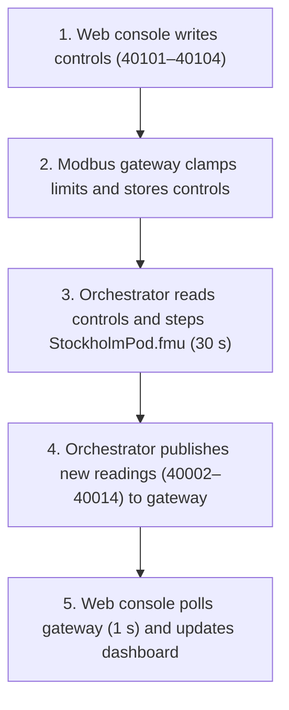
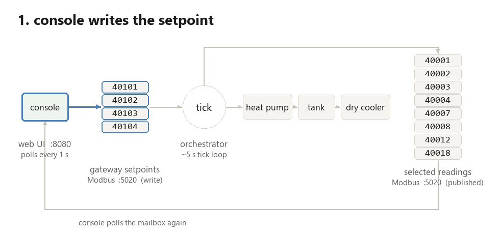
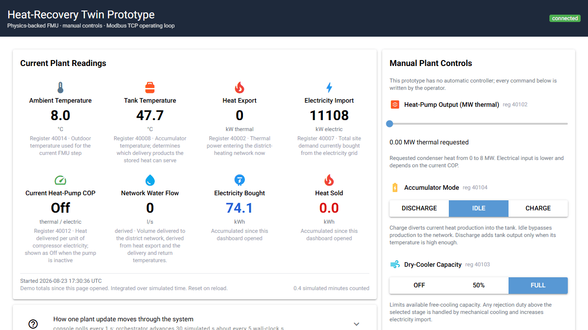
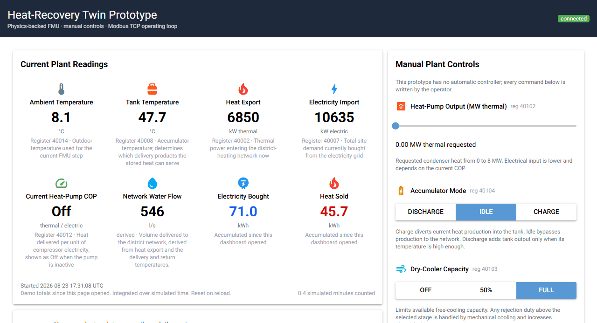

# Building a Digital Twin's Skeleton, End to End

<!-- markdownlint-disable MD013 -->

<!-- markdownlint-enable MD013 -->

Picture a data-center pod beside Stockholm's district-heating network. Its
servers reject heat continuously. A heat pump can lift that heat to a useful
temperature, while an accumulator can shift delivery in time. In Post 1, we
built this plant in Modelica and tested it against a Stockholm weather year.

A model can answer a design question. How does it become something an operator
can actually use?

A digital twin needs more than a simulation and a dashboard. Measurements from
the physical plant must reach the model, and the model's predictions or
approved commands must return through a controlled data path. Calibration must
also keep both sides aligned as the plant changes. Without that connection, the
model remains a simulation tool rather than a digital twin.

We use the same plant model here. Exported as `StockholmPod.fmu`, it
becomes the physics core of an operating loop. Before building the software, it
helps to see the wiring that would place this FMU inside a real digital twin.

## Wiring a Real Twin

Connecting a model to an operating plant takes several distinct hops.

<!-- markdownlint-disable MD013 -->

<!-- markdownlint-enable MD013 -->

A physical sensor produces an electrical or digital field signal, such as a
resistance or a 4–20 mA current loop. A PLC or remote-I/O module reads that
signal, scales it into an engineering value, and maps the value to a register.
The Modbus TCP gateway exposes those registers over the network. The
orchestrator then decodes them for the FMU and writes approved commands back
through the same chain.

Measured and predicted signals remain separate. Comparing them is how an
operational twin detects drift and calibrates uncertain model parameters.

This post builds the software side of that architecture: the console, gateway,
orchestrator, and the FMU exported from the Post 1 model. It does not connect a
physical plant or PLC. The result is an operating simulation prototype and the
software skeleton for a future digital twin. The
[Digital Twin Consortium](https://www.digitaltwinconsortium.org/glossary/glossary/)
reserves the full term for a model synchronized with a real-world entity.

## Closing the Loop

How does a browser command reach a Modelica model?

The console and orchestrator never call each other directly. They communicate
through a Modbus TCP gateway whose register map acts as their shared contract.
The console writes setpoints. On its next tick, the orchestrator reads those
setpoints, advances the FMU, and publishes the resulting values back to the
gateway. The console then picks them up on its own polling clock.

The protocol is real Modbus TCP. TCP changes the transport, while the familiar
Modbus register and function-code model remains. The
[Modbus Organization](https://www.modbus.org/introduction-to-modbus)
documents the protocol in detail.

The operator-facing slice of the map is small:

| Register | Signal | Access | Meaning |
| --- | --- | --- | --- |
| 40002 | `Q_sold` | RW* | Heat delivered to the network, kW |
| 40007 | `P_grid` | RW* | Grid import, kW |
| 40008 | `T_tank_top` | RW* | Accumulator temperature, °C |
| 40012 | `COP_hp` | RW* | Current heat-pump COP |
| 40014 | `T_amb` | RW* | Outdoor dry-bulb temperature, °C |
| 40101 | `u_prod` | W | Delivery product |
| 40102 | `Q_hp_set` | W | Heat-pump thermal output, kW |
| 40103 | `y_dry` | W | Dry-cooler capacity, 0–1 |
| 40104 | `y_chg` | W | Tank command, -1–1 |

Each register sits on one piece of equipment inside the plant: four orange
controls that the operator adjusts, and five green readings that the model
reports back.

<!-- markdownlint-disable MD013 -->

<!-- markdownlint-enable MD013 -->

The asterisk matters. The prototype uses one holding-register space, so the
readings are writable at the protocol level. Calling them readings is an
interface convention, not an access-control guarantee.

The gateway still enforces physical bounds on the command block, clamping every
incoming write to its allowed range and logging whether it was clamped. It also
initializes two command registers away from zero: `y_chg` starts at raw `500`
(idle) and `y_dry` starts at raw `1000` (full fan capacity), so a freshly
started stack neither drains the tank nor forces mechanical cooling before an
operator touches a control.



## Following One Tick

When does a changed setpoint affect the model?

The orchestrator advances the plant by 30 simulated seconds per tick. Docker
runs the model at six times real speed, so a tick occurs about every five
wall-clock seconds. The console polls once per second. A command can therefore
wait in the gateway for almost one plant cycle before the FMU sees it.

<!-- markdownlint-disable MD013 -->

<!-- markdownlint-enable MD013 -->

The core of that loop remains deliberately small:

```python
setpoints = {}
for name, (addr, scale) in WRITE_REGISTERS.items():
    raw = io.read_holding_registers(addr, 1)[0]
    setpoints[name] = raw / scale
setpoints["y_chg"] = setpoints["y_chg"] / 500.0 - 1.0

p_it, t_amb = generate_disturbance(t_sim_s)
t_net_sup, t_net_ret = network_temperatures(t_amb)
inputs = PlantInputs(
    P_it=p_it,
    T_amb=t_amb,
    T_net_sup=t_net_sup,
    T_net_ret=t_net_ret,
    Q_dem=network_heat_demand(t_amb),
    **setpoints,
)

outputs = plant.do_step(dt_s, inputs)
```

Modbus holding registers are unsigned 16-bit integers. Temperatures use a scale
of 100, whereas power stays at 1 kW resolution to fit inside 65,535. The tank
command avoids signed registers through an offset encoding: the engineering
range from -1 to 1 travels as 0 to 1000 and returns through `raw / 500 - 1`.
Sub-zero outdoor temperatures on `T_amb` use 16-bit two's complement on the
wire instead.

Until live or historical feeds arrive in Post 3, `generate_disturbance` drives
the plant with two deterministic 24-hour sine waves: a 10 MW IT load with a
±0.4 MW ripple and an outdoor temperature of 7 ± 6 °C. From that outdoor
temperature, `network_temperatures` and `network_heat_demand` evaluate the same
Energiforsk 2024:1059 supply/return curves and degree-day demand curve defined
in Post 1.

## Stepping the FMU

Each orchestrator tick advances the compiled Modelica plant by one 30-second
communication step. `FMUPlantModel` loads the same `StockholmPod.fmu` used for
the annual study, sets the FMI inputs, calls `fmi2DoStep`, and reads the
outputs.

The FMU retains thermal state across ticks. Each call resumes from the previous
tank temperature, which is what turns a sequence of operator commands into a
continuous physical trajectory.

That state currently lives only inside the orchestrator process. Restarting it
creates a new FMU instance and resets the tank to 47 °C. A physical tank would
remain hot, so an operational twin would need checkpoint recovery or state
estimation from measurements.

## Reading the Response

Operating the loop exposes physical interactions that a wire-level connection
test cannot see.

Because the live disturbance wave starts at 7 °C and spans 1 to 13 °C, mild
weather is what the browser console shows out of the box. Select Retur, and the
47 °C liquid loop is already warm enough to serve the return-line product
through direct heat exchange. Heat export appears while the heat-pump command
remains at 0 MW and the COP display reads **Off**. The cheapest path needs no
compressor lift.

<!-- markdownlint-disable MD013 -->

<!-- markdownlint-enable MD013 -->

Deep-winter cases outside that 1 to 13 °C live wave are pinned in the pytest
suite, which drives `FMUPlantModel` directly. At -20 °C, the network return
rises to 59 °C, above the liquid-loop temperature. With no heat-pump duty
commanded, Retur delivers nothing.

Higher-temperature products expose the electrical cost of lift. In the -10 °C
pytest scenario, a 3 MW thermal command gives Inblandning a COP of 6.43 and a
compressor draw of 466.7 kW. Prima asks for 92.5 °C under the same conditions.
Its COP falls to 4.02 and compressor power rises to 746.6 kW. The thermal
setpoint has not changed. The required temperature has.

Storage adds time to the problem. A tank starting at 47 °C cannot directly
serve a high-temperature product, and the 500 m³ water volume warms slowly. Back
in the live GUI's mild-weather default, selecting Prima and commanding
heat-pump output shows the current COP immediately. Switching the accumulator
to Charge then diverts production into the tank, so the tank temperature climbs
gradually over successive ticks.

<!-- markdownlint-disable MD013 -->

<!-- markdownlint-enable MD013 -->

We built the loop against 47 pytest checks covering the FMU physics, register
contract, gateway clamping, console I/O, tick loop, and a real TCP round trip.
The integration test reads through to the final register in the contract, so a
truncated datastore fails loudly. The standalone Post 2 release ships the
runnable stack, while the full test suite runs in GitHub Actions whenever the
model or wire contract changes.

## Running the Prototype

Docker runs the gateway, orchestrator, and web console together with no local
Modelica or C toolchain required:

```bash
docker compose up --build
```

Open `http://localhost:8080`. One overview card places the current plant
readings beside the energy accumulated since the dashboard opened. It reports
ambient and tank temperatures, heat export, electricity import, current COP,
and the water flow sold to the network, derived from the heat export and the
delivery and return temperatures.
**Electricity Bought** and **Heat Sold** integrate from the first valid reading
using simulated time. Their UTC start timestamp appears below the values, and
both totals reset when the page reloads.

The heat-pump slider spans 0 to 8.0 MW thermal. Accumulator mode uses
**Discharge / Idle / Charge**, while dry-cooler capacity uses **Off / 50% /
Full**. Run `docker compose down` when finished.

## Drawing the Boundary

Six deliberate limits separate this prototype from a deployed plant system:

- The FMU runs against synthetic IT load and weather traces.
- Every command comes from a human. There is no automatic controller.
- FMU state disappears when the orchestrator restarts.
- Registers retain only the latest values. The dashboard's energy totals are
  session-only and reset on reload.
- Reading registers remain writable in this local Modbus design.
- The model puts no connection-capacity limit on combined bypass and tank
  discharge, so commanding discharge on top of direct loop delivery sells both
  streams at once.

That list is the boundary between a useful prototype and an operational twin.
The model can now be operated. It cannot yet observe and reconcile itself with
a physical plant.
