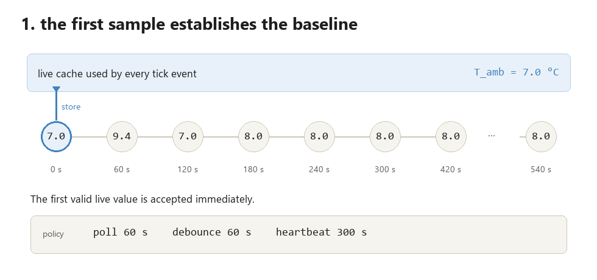
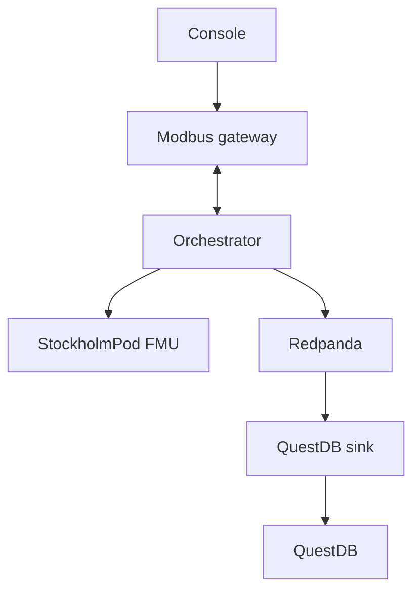
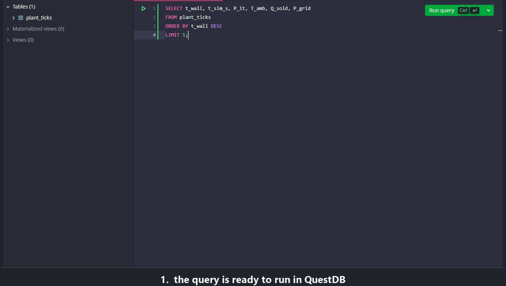

# A Digital Twin Needs a Memory

Post 2 put the Modelica plant from Post 1 inside an operating loop. A web
console wrote setpoints, a Modbus TCP gateway held them, and an orchestrator
stepped the FMU. It was still a simulation tool because no physical sensors or
plant commands were connected. It also had another limitation: every completed
tick disappeared.

A real digital twin needs both connection and memory. Current measurements
synchronize the model with the plant. Historical inputs and outputs show how
the two have behaved over time. Without that history, calibration, replay, and
later control have no reliable record to work from.

This post builds that memory layer. Every completed plant tick becomes one
versioned event in Redpanda and one deduplicated row in QuestDB. The operating
simulation still runs on a laptop. It simply stops forgetting.

## The Loop Remembered Only Now

Post 2 had two useful views of the same instant. The console could read the
latest register values, and the orchestrator held the latest
`PlantOutputs`. Neither answered what the tank temperature was ten minutes
ago, which setpoint caused it, or whether a restarted consumer had stored the
same tick twice.

That distinction matters. A dashboard is allowed to care only about now. A
controller needs recent history. Calibration needs a longer one. An audit
trail needs to know which inputs and outputs belonged to the same model step.

So we did not stream isolated measurements. We wrapped each completed step as
one event:

```python
event_id = f"{run_id}:{step}"

TickEvent(
    event_id=event_id,
    t_sim_s=t_sim_s,
    t_wall_utc=t_wall,
    inputs=snapshot.inputs,
    outputs=snapshot.outputs,
)
```

The event carries all nine plant inputs, all thirteen outputs, the electricity
price used for that step, source labels, and a schema version. One step in the
FMU is one message on the wire.

Each event is one co-simulation communication step. The inputs are the
zero-order-hold vector applied at the start of the `fmi2DoStep` call, and the
outputs are sampled when that call returns. Every record therefore carries a
complete cause and effect, which is exactly what later calibration needs to
trace each output back to the input vector that produced it.

## Two Clocks, Kept Separate

The data backbone records two times because they answer different questions.

`t_sim` is where the FMU is in its simulated world. It advances by exactly
30 seconds per tick. Change the speed factor and this clock does not change.

`t_wall` is when the orchestrator handled that event in UTC. At the demo's
6× speed, consecutive 30-second simulation steps arrive roughly five wall
seconds apart.

Conflating the two makes a replay look like new plant history. It also makes
simulation speed leak into later control and calibration. Here, a replay keeps
its original `t_sim`, `t_wall`, and `event_id`. Nothing is stamped again
at the sink.

Replay must reproduce the original trajectory, so a given `event_id` always
carries the same `t_sim` and the same input/output pair. Re-stamping either
at the sink would silently break that guarantee.

## The Conveyor Belt and the Warehouse


We used [Redpanda](https://docs.redpanda.com/labs/docker-compose/single-broker/)
as the Kafka-compatible conveyor belt. The orchestrator publishes JSON to
`dc2dh.plant-ticks.v1`, keyed by `run_id:step`, and waits for the broker's
acknowledgement before advancing its counters.

That acknowledgement is synchronous. The tick does not advance until the
broker accepts the event, so the loop cannot outrun a slow broker. The cost is
small on a local bus: answers take milliseconds. It is the price of a record
that survives consumer restarts.

The QuestDB sink is a separate consumer. It writes a flattened row to
`plant_ticks` and commits the Kafka offset only after the database accepts
the row. If the sink dies after the database write but before the offset
commit, Kafka sends the event again. That is normal at-least-once delivery,
not an edge case.

QuestDB's WAL table handles the replay:

```sql
TIMESTAMP(t_wall)
PARTITION BY DAY WAL
DEDUP UPSERT KEYS(t_wall, event_id)
```

QuestDB requires the designated timestamp in the deduplication key. The stable
event ID distinguishes two runs or steps that might share that timestamp.
The database replaces a replayed row instead of quietly doubling the history.
That follows QuestDB's own
[deduplication](https://questdb.com/docs/concepts/deduplication/) and
[delivery-semantics](https://questdb.com/docs/concepts/delivery-semantics/)
guidance.

This is not exactly-once transport. It is the more useful property here:
at-least-once delivery plus idempotent storage.

## Live Inputs Need Restraint

A live feed should not be allowed to jerk the plant around simply because an
endpoint returned one odd sample.

The bundle includes a concrete
[Open-Meteo](https://open-meteo.com/en/docs) adapter for Stockholm outdoor
temperature and a provider-neutral JSON adapter for electricity price.
The price adapter is deliberately configurable. Actual Nord Pool or ENTSO-E
access depends on the data contract and credentials. We did not hide that
behind a fake public endpoint.

The adapters pass through a small timing gate:

- Poll no faster than every 60 seconds.
- Accept a changed value only after it remains stable for 60 seconds.
- Refresh the accepted live cache after 300 unchanged seconds as a
  heartbeat.
- Retain the last accepted value if a request fails.



The synthetic traces remain the default so anyone can reproduce the demo
without internet access or credentials. Set `LIVE_FEEDS=1` to enable live
weather. Add `PRICE_FEED_URL`, `PRICE_FEED_FIELD`, and optionally a bearer
token to enable a price source.

## What Runs Now

The compose stack has six services:



Run it from the repository root, move a setpoint, and open QuestDB's web
console:

```bash
docker compose up --build
```

The operating console remains at <http://localhost:8080>. QuestDB is at
<http://localhost:9000>. This query shows the stored loop, with powers and
heat in kW and temperatures in °C:

```sql
SELECT t_wall, t_sim_s, P_it, T_amb, Q_sold, P_grid
FROM plant_ticks
ORDER BY t_wall DESC
LIMIT 20;
```



Move the heat-pump slider in the console and re-run this query. The matching
`Q_sold` and `P_grid` arrive as the top row: the same physics the tiles
showed, now stored and searchable.

The Redpanda broker is intentionally single-node and capped at 512 MB. It is a
local checkpoint, not a production cluster. Allocate at least 4 GB to Docker
for the full stack and its image builds.

Two properties matter most here, and we pin both with tests in our development
repository. One sink test asserts the Kafka offset commits only after a
successful QuestDB write. One dedup test replays an event and asserts the row
count does not move.

## What This Still Is Not

Two kinds of boundary separate this checkpoint from an operational twin.

Fidelity boundaries change the science:

- There is no physical data-centre connection. Live IT load is still
  synthetic.
- FMU state dies with the orchestrator. A restart resets the modelled tank to
  47 °C while a physical tank would stay hot. Post 5's calibration has to
  restore or estimate that state from history.
- There is no historical backfill. The broker keeps what this run produced,
  and nothing re-seeds the warehouse from an archive.
- The price adapter is only as trustworthy as the endpoint you configure.

Operations boundaries concern deployability:

- There is no TLS, authentication, or high availability. This is a
  laptop-scale stack.
- There is no schema registry. `schema_version=1` rides on the wire, but
  nothing enforces migrations.
- There is no alarm management. Nothing pages anyone when a feed or sink
  stalls.

Those are real boundaries. They do not weaken what this checkpoint proves:
the exact input/output pair used by every model step can survive process
boundaries, consumer retries, and time.

The next post will finally put a controller on this history. The manual slider
will get competition from a rule-based service, and the write arbiter will
have to do more than log who wrote last.

If you want to follow that build, the complete runnable snapshot is in the
repo.
