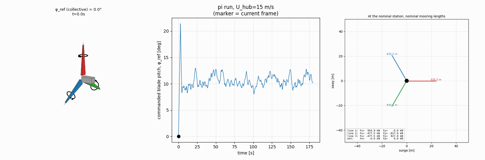
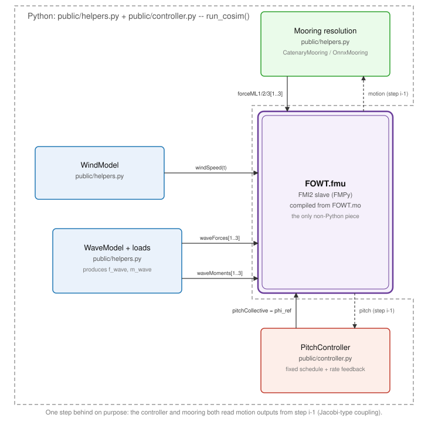
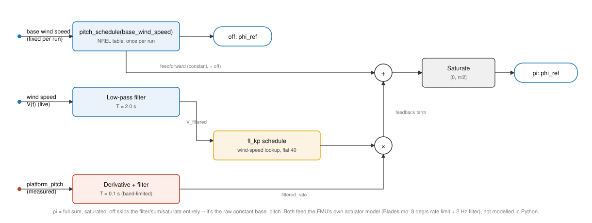
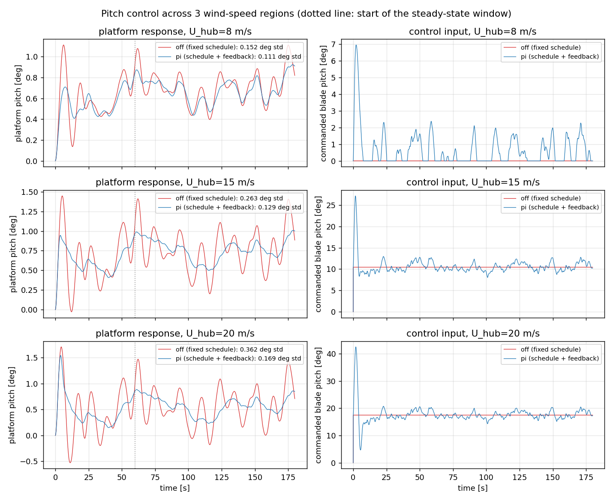
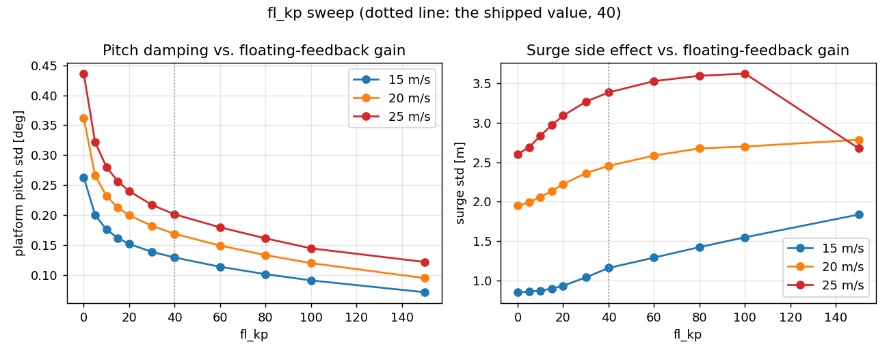
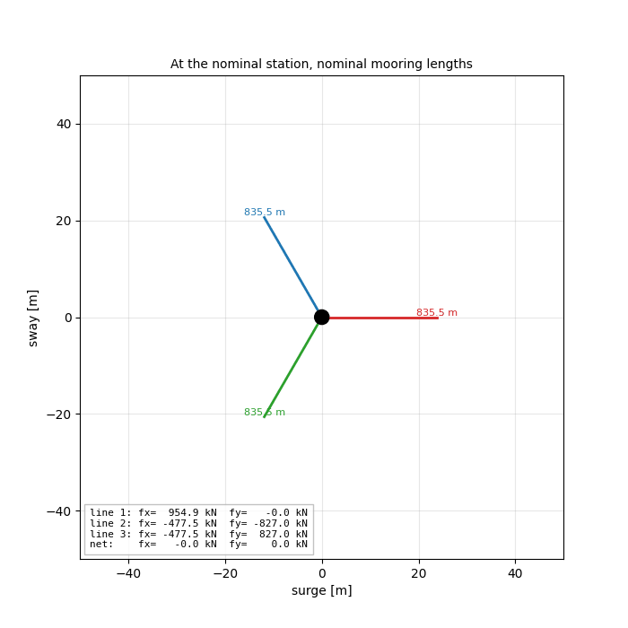

# Pitch Damping and Mooring Repositioning: The Same Kind of Control?

*Vedat Senol and Ogulcan Isitman*

The FOWT model from our previous post could simulate platform motion, resolve the mooring loads, and report whether a run stayed within its limits. It could observe the system, but it could not change its response.

This post adds two interventions. The first adjusts collective blade pitch while the simulation is running. The second changes mooring-line lengths before a run begins. Both influence platform motion, but only one closes a feedback loop.

---

## Separating Control from Configuration

When does an adjustment become control?

The pitch compensator reads the platform pitch angle at every co-simulation step. It estimates pitch rate, filters that estimate, and modifies the collective blade-pitch command. Platform motion therefore changes the next command sent to the turbine model.

The structure comes from floating feedback used in NREL's ROSCO reference controller (Abbas et al., 2022, [10.5194/wes-7-53-2022](https://doi.org/10.5194/wes-7-53-2022)). ROSCO adds platform-rate feedback to a conventional generator-speed PI pitch controller. Our model does not contain that underlying speed-control loop. It uses only the platform-rate term on top of a fixed operating-pitch schedule.

This distinction matters. The model demonstrates how motion feedback changes the coupled platform response. It does not validate a complete wind-turbine controller or reproduce the negative aerodynamic-damping problem that motivates floating feedback in ROSCO.

Mooring repositioning is different. The solver receives a target location and calculates line lengths that balance the horizontal mooring forces there. It runs once, outside the dynamic simulation. The result is a proposed configuration for a later run, similar to selecting any other model parameter.

---

## Locating the Feedback Loop

Where does the controller sit in the co-simulation?

The compiled FMI 2.0 model contains the rigid-body platform, rotor thrust model, blade-pitch actuator, and structural connections. The controller and mooring calculations remain in Python.

*The Python loop evaluates mooring forces and the pitch controller outside the FMU. The compiled model advances the platform and actuator dynamics.*

At step $i$, Python reads the motion returned at step $i-1$. The mooring model uses that state to resolve three line forces. The controller uses the same delayed state to update collective pitch. Both inputs are then held over the next FMU communication step.

This is explicit co-simulation coupling. We do not iterate between Python and the FMU within a timestep. A communication step of 0.02 s is small relative to the platform and wave periods considered here.

The API still calls the feedback mode `pi` for notebook compatibility. There is no integral term in the implemented controller.

---

## Building the Pitch Compensator

What exactly changes when feedback is enabled?

The baseline command is a fixed NREL 5 MW operating-pitch schedule. We evaluate it once at the run's mean hub-height wind speed and hold it constant:

$$
\beta_\mathrm{base} = \beta_\mathrm{schedule}(U_\mathrm{hub})
$$

The feedback mode adds filtered platform pitch rate:

$$
\beta_\mathrm{cmd} = \operatorname{sat}\!\left(\beta_\mathrm{base} + K_\mathrm{float}\,\dot{\theta}_\mathrm{filtered}\right)
$$

The saturation range is 0 to 90 degrees. Python does not apply a second pitch-rate limit. The command enters `Blades.mo`, where the FMU's 8 deg/s slew-rate limiter and 2 Hz actuator filter determine the actual collective blade pitch.

*The fixed operating point is common to both cases. The blue case adds only the platform-rate feedback term.*

The default $K_\mathrm{float}$ is 40 s. The implementation supports a wind-speed-dependent gain schedule, but the demonstrated schedule is flat between 11.4 and 25 m/s. Consequently, the controller's filtered wind signal does not change the gain in these runs.

---

## Comparing Platform Response

Does the rate term reduce platform pitch motion?

We ran the baseline and feedback cases for 180 s at three wind speeds, with $H_s = 3$ m, $T_p = 9$ s, and turbulence intensity of 0.10. The first 60 s are excluded from the statistics to remove the startup response.

*Platform pitch is shown on the left and commanded collective blade pitch on the right. Red is the fixed schedule. Blue is the same schedule with rate feedback.*

| $U_\mathrm{hub}$ | Case           | Pitch mean | Pitch std | Surge mean | Surge std |
| ------------------ | -------------- | ---------: | --------: | ---------: | --------: |
| 8 m/s              | Fixed schedule |     0.71° |   0.152° |     5.21 m |    0.43 m |
| 8 m/s              | Rate feedback  |     0.68° |   0.111° |     5.04 m |    0.41 m |
| 15 m/s             | Fixed schedule |     0.78° |   0.263° |     5.67 m |    0.85 m |
| 15 m/s             | Rate feedback  |     0.77° |   0.129° |     5.42 m |    1.16 m |
| 20 m/s             | Fixed schedule |     0.59° |   0.362° |     4.23 m |    1.95 m |
| 20 m/s             | Rate feedback  |     0.57° |   0.169° |     3.78 m |    2.45 m |

Pitch standard deviation falls by 27% at 8 m/s, 51% at 15 m/s, and 53% at 20 m/s. The mean pitch angle changes much less. For these runs, the feedback term is damping an oscillation rather than removing the platform's mean inclination by de-loading the rotor.

The improvement is not free. Surge standard deviation rises by 36% at 15 m/s and 26% at 20 m/s. It falls by about 6% at 8 m/s. The controller therefore changes the coupled response rather than reducing every motion simultaneously.

There is another limitation below rated wind speed. At 8 m/s, a real turbine would normally remain near fine pitch and regulate rotor speed through generator torque. This model has no generator-speed, torque, or power state. It can show the motion response to nonzero pitch activity, but it cannot calculate the associated energy cost.

---

## Selecting the Feedback Gain

How far should the feedback gain be pushed?

We swept $K_\mathrm{float}$ from 0 to 150 s at 15, 20, and 25 m/s. Pitch variability continued to fall throughout the tested range. Surge variability generally increased, especially at 15 and 20 m/s.

*Higher gain improves pitch damping over the tested range, while the surge response sets a practical trade-off. The dotted line marks the selected value of 40 s.*

At 20 m/s, pitch standard deviation decreases from 0.362° with no feedback to 0.095° at $K_\mathrm{float} = 150$ s. That does not make 150 s the preferred setting. The sweep does not include actuator duty, power production, structural loads, or robustness to other sea states.

We retained 40 s as a conservative constant gain. It provides a clear pitch reduction at all three comparison speeds while remaining well below the upper end of the sweep.

A timestep check at 15 m/s produced approximately 0.154° pitch standard deviation with communication steps of 0.02, 0.01, and 0.005 s. The reported response is therefore insensitive to further timestep reduction over this range.

---

## Keeping the Command Collective

What does collective blade pitch leave out?

The FMU accepts one `pitchCollective` input and sends the same command to all three blades. The animation at the top uses the real command from the 15 m/s feedback run to show that motion.

Collective pitch can influence rotor thrust and platform pitch. It cannot target blade-specific 1P or 2P loading. Individual pitch control would require three actuator channels and rotor-azimuth feedback, neither of which exists in this model.

The rotor rotation in the animation is illustrative because the FMU does not export rotor azimuth.

---

## Repositioning the Mooring System

Can the same model propose a different equilibrium position?

At the nominal line length of 835.5 m, moving the platform to $+4$ m surge and $+4$ m sway produces the following horizontal fairlead forces:

| Line |   $f_x$ |    $f_y$ |
| ---- | --------: | ---------: |
| 1    |  774.7 kN |    -3.9 kN |
| 2    | -659.5 kN | -1137.5 kN |
| 3    | -447.0 kN |   762.0 kN |

The net force is $(-331.8, -379.5)$ kN. The nominal system therefore pulls the platform back toward the origin, as expected.

There are two different ways to hold the platform at the target. An external environmental force could balance the nominal mooring system, or the line lengths could be changed until the mooring forces balance without that external load. The solver shown here performs the second calculation.

Minimizing the total line-length change while driving the horizontal force residual to zero gives:

| Line |  Length | Change |   Tension |
| ---- | ------: | -----: | --------: |
| 1    | 831.4 m | -4.1 m | 1159.0 kN |
| 2    | 841.1 m | +5.6 m | 1147.5 kN |
| 3    | 834.0 m | -1.5 m | 1156.0 kN |

The new configuration retains similar horizontal stiffness and seabed contact:

| Check                   |              Nominal |           New configuration |
| ----------------------- | -------------------: | --------------------------: |
| Horizontal stiffness    | 80.2 kN/m, isotropic | 81.3 / 79.4 kN/m, principal |
| Seabed contact per line |        Not evaluated |                223 to 236 m |

*This is the static solve, not a simulated repositioning transient. The labels show the calculated line lengths even though their visual changes are exaggerated.*

The force balance, stiffness, and seabed-contact checks make the proposed geometry plausible. It has not been run through the dynamic FMU at the new equilibrium, and it does not represent a turbine balancing continuous rotor thrust. We therefore treat it as a configuration study.

---

## Reading the Result

What did the two interventions actually demonstrate?

Platform-rate feedback reduced pitch standard deviation by 27% to 53% in the tested cases. At two wind speeds it also increased surge variability, showing why controller assessment must include coupled platform motion.

The mooring calculation answered a different question. It found line lengths that statically balance a chosen offset while preserving similar horizontal stiffness and seabed contact. It did not close a loop or prove dynamic feasibility.

Both examples use the same digital twin, but they occupy different places in the workflow. One modifies the next timestep from measured motion. The other changes the conditions of the next simulation.
