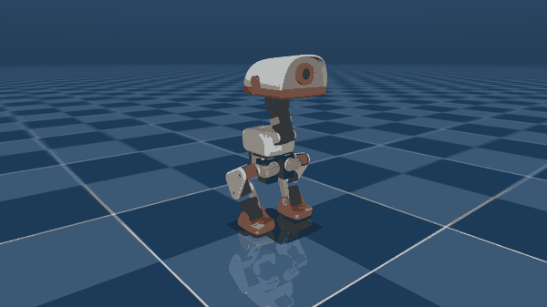
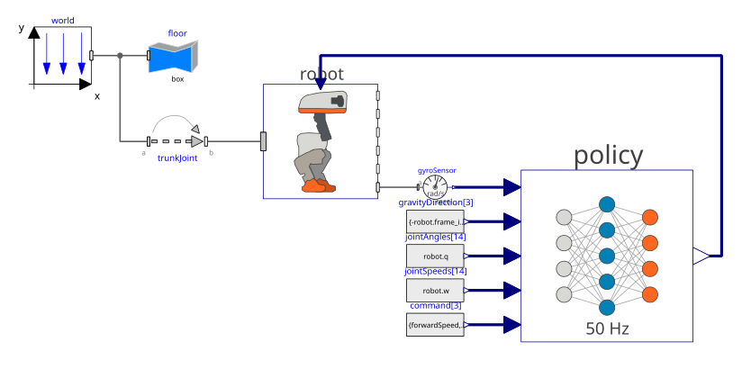
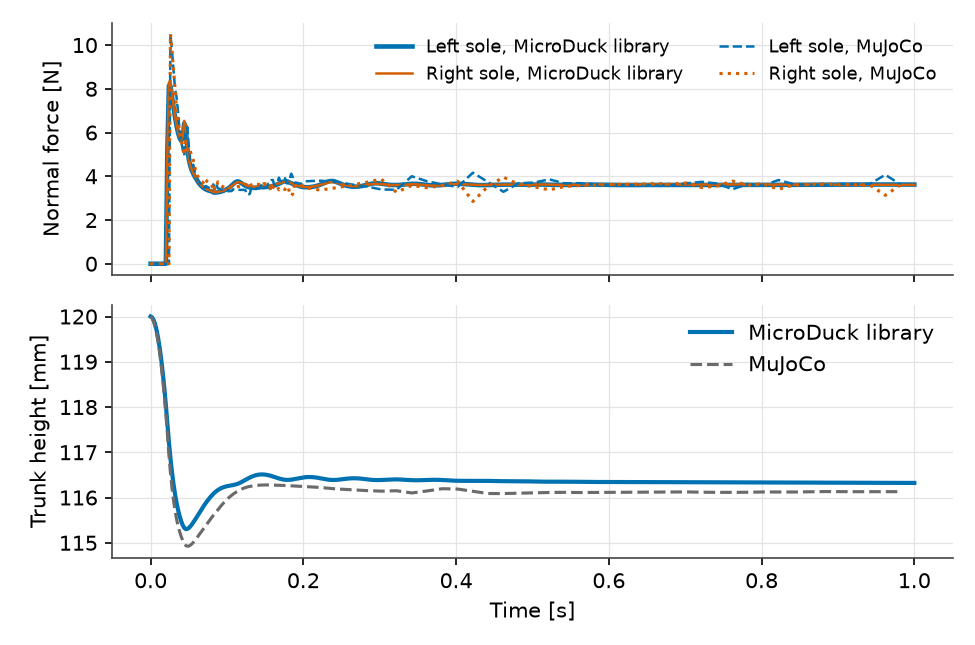
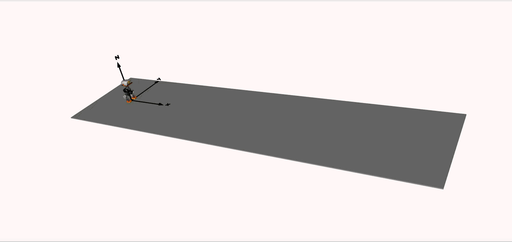
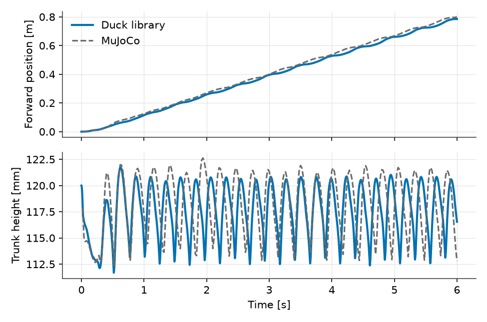

# Why Rebuild a Walking Robot Duck in Modelica?

Vedat Senol and Ogulcan Isitman

A flock of 25 cm
[MicroDuck robots walked out on stage with Jensen Huang at NVIDIA GTC](https://www.youtube.com/watch?v=Nt6d62vN7CU).
Pollen Robotics and Hugging Face released the
[MuJoCo training environment](https://github.com/pollen-robotics/microduck_rl)
and [neural network weights](https://huggingface.co/pollen-robotics/microduck-policies)
under Apache-2.0, and the trained policy walks on real hardware. So why did we
rebuild the robot in Modelica?

Because "does it walk on stage?" is only the first question.

*Figure 1: The MicroDuck walking under its trained policy at a 0.3 m/s forward
command, rendered in MuJoCo.*

## Two Simulators, Two Jobs

The MicroDuck is a 25 cm biped with 14 Dynamixel XL330 servos and a modelled
mass of 0.737 kg. Its policy reads the IMU and joint states 50 times a second
and sends 14 joint targets back. MuJoCo is the right tool to train it: on a
desktop CPU it runs a 6 s walk in 0.55 s, and reinforcement learning needs
millions of those.

Speed comes from specializing in rigid-body mechanics and contact. MuJoCo has
no electrical or thermal domain, so in
[`microduck_rl`](https://github.com/pollen-robotics/microduck_rl) the built-in
actuator is disabled and a Python callback runs before every `mj_step` to
compute motor torque from the
[BAM XL330 model](https://github.com/Rhoban/bam) at a fixed supply voltage and
fixed winding resistance. Rebuilding the robot in Modelica puts the 3D multibody
tree, the 14 servo drivetrains, the shared two-cell battery pack
(`useBattery = true`, where pack voltage sag is solved together with current
spikes) and the servo thermal networks (`useThermal = true`, where winding
copper loss $R i^2$ and gearbox friction $\tau_{\mathrm{f}}\omega$ heat the
servo and raise its resistance) into one coupled system of equations, and
exports the whole plant as a standalone FMU (`DuckPlant.fmu`) for Python.

*Figure 2: Diagram view of `WalkingTest` in OpenModelica, wiring the 3D
multibody `Robot` plant, IMU and joint sensors to the 50 Hz `WalkingPolicy`
block.*

## Verify Before Adding Anything

A second model is worthless if it disagrees with the first one for reasons
nobody understands. Before extending the plant, we matched the baseline
Modelica model against the MuJoCo model it was generated from.

At [Nous Engineering & Research](https://nouseng.co), we built the `MicroDuck`
library directly from the training MJCF file, so masses, inertias and joint
frames are identical by construction. Forward kinematics agree to
$4 \times 10^{-13}\ \mathrm{m}$. Each joint drives a 3D revolute joint through a
`PositionServo` with the identified XL330 parameters (torque constant
0.346 N·m/A, winding resistance 2.50 Ω, rotor inertia 0.00157 kg·m², Coulomb
and viscous friction) and 2° of gear play. Under each sole sit eight
`PointContact` elements implementing MuJoCo's soft pyramidal contact law.

First, drop the robot from 2.8 mm onto its soles with the servos holding the
home pose at `positionGain = 800`. Both simulators peak near 0.05 s (8.4 N
against 10.5 N per sole, trunk dipping to 115.3 mm against 114.9 mm) and settle
at half of the 7.2 N robot weight per sole, with trunk height within 0.1 mm
after 0.2 s.

*Figure 3: Sole normal forces (top) and trunk height (bottom) when dropped from
2.8 mm at `positionGain = 800`, compared with MuJoCo.*

Next, close the loop with the 50 Hz `WalkingPolicy` block and its 22.5 ms
training command delay. Same policy, same 0.3 m/s command, two simulators.
After 6 s the Modelica robot has covered 0.797 m against 0.799 m in MuJoCo. Its
22 stance touchdowns land 25 ms from MuJoCo's on average, at a mean trunk height
of 118 mm, and over the last 4 s it walks at 0.137 m/s against 0.132 m/s.

*Figure 4: The Modelica MicroDuck walking under the same trained policy at a
0.3 m/s forward command, rendered in OpenModelica.*

*Figure 5: Forward position (top) and trunk height (bottom) over a 6 s walk.
Solid: the Modelica MicroDuck library. Dashed: MuJoCo, same policy and command.*

## What the Plant Answers Next

In Modelica a 6 s walk takes about 6 s on a desktop CPU against 0.55 s in
MuJoCo. Nobody should train a policy this way. Once the policy is trained and
the plant is verified, the equation-based model answers actuator and power
questions across domains:

- **Soft servos used as torque commands.** At the walking gain register of 200
  (0.589 N·m/rad, four times softer than the standing gain of 800), the policy
  swings its angle targets 24° RMS ahead of the knees, using position error as a
  torque command while staying below 30% of the 1.01 N·m stall torque.
- **Supply voltage and coupled battery sag.** Dropping the pack from 7.4 V to
  6.5 V cuts mean servo power from 2.26 W to 1.85 W, and on the coupled 2S pack
  (`useBattery = true`) the 0.92 A touchdown spike pulls terminal voltage down
  by 64.5 mV across all 14 servos simultaneously.
- **Servo heating and fault load shift.** With `useThermal = true`, the 14
  servos dissipate 2.17 W (1.79 W in copper, 0.37 W in friction), and an
  unpowered left knee (`kneeGain = 0`) shifts 83% more copper heating (0.41 to
  0.75 W) onto the opposite right knee.

MuJoCo and Modelica solve different halves of the problem. Train the policy in
the fast contact engine, then bring the weights into an equation-based plant
where the drivetrains, the battery, the thermal network and the contact law are
open equations you can inspect and extend. The
[`MicroDuck` library](https://github.com/nouseng/libraries/tree/main/RoboticsAtelier/MicroDuck)
is developed by [Nous Engineering & Research](https://nouseng.co) and runs in
OpenModelica with the Modelica Standard Library. If a training simulator and
your hardware disagree, that gap is where we work.

## References

- **MuJoCo robot model and meshes:**
  [`pollen-robotics/microduck_rl`](https://github.com/pollen-robotics/microduck_rl)
  (`src/mjlab_microduck/robot/microduck/`, Apache-2.0).
- **Trained neural network walking policy (`velstand.onnx`):**
  [`pollen-robotics/microduck-policies`](https://huggingface.co/pollen-robotics/microduck-policies)
  (Apache-2.0).
- **Identified Dynamixel XL330 actuator model:**
  [`Rhoban/bam`](https://github.com/Rhoban/bam)
  (`bam/params/xl330/m6.json`, Apache-2.0).
- **Modelica plant library (`MicroDuck` & `MicroDuckTest`):**
  [`nouseng/libraries/RoboticsAtelier/MicroDuck`](https://github.com/nouseng/libraries/tree/main/RoboticsAtelier/MicroDuck)
  (BSD 3-Clause).
- **Post 1 notebook, FMU and MuJoCo files:**
  [`nouseng/Blogs/Microduck/post-1`](https://github.com/nouseng/Blogs/tree/main/Microduck/post-1).
