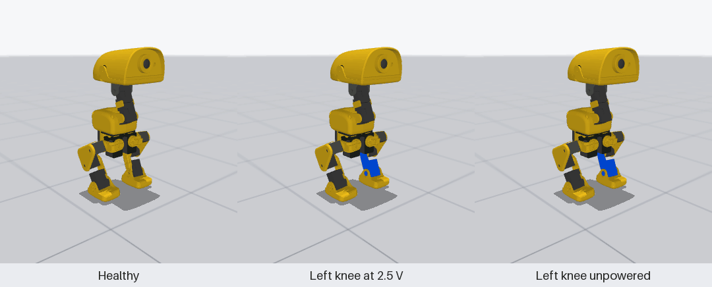
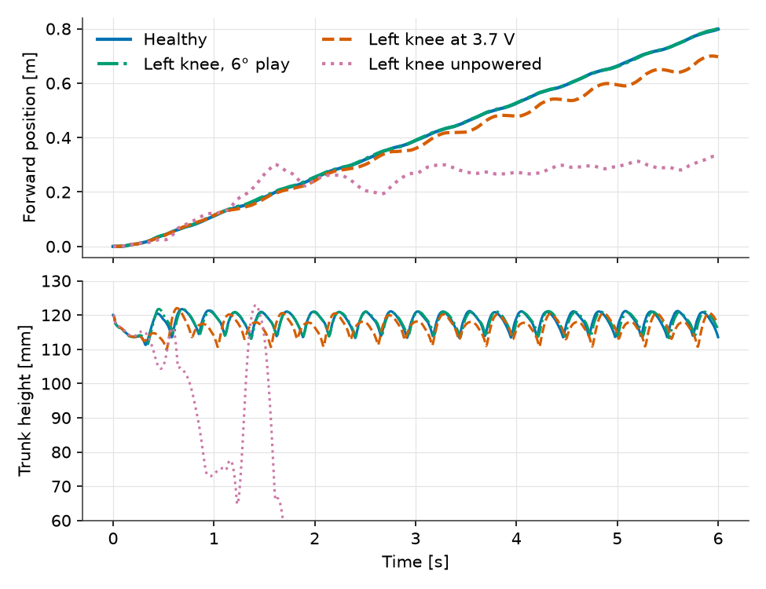
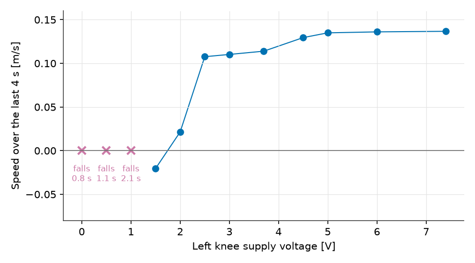
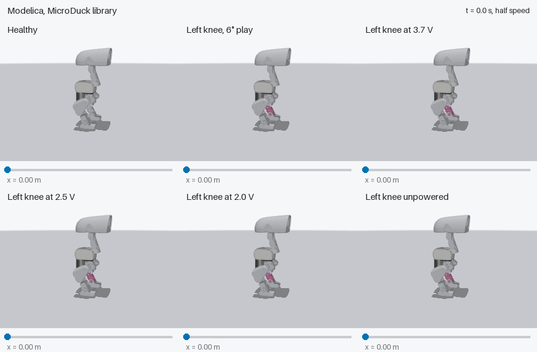

# Can a Lame Duck Still Walk?

Vedat Senol and Ogulcan Isitman

A servo rarely fails all at once. Its gear wears and the play grows. Its
supply connector loosens and the motor sees less voltage. Sometimes it simply
stops. The MicroDuck's neural network walking policy was never shown most of
these cases. How lame can the duck get before it stops walking?

On hardware each answer costs a damaged servo, and in a training simulator the
servo is not detailed enough to fail realistically. In the Modelica plant from
[Part 1](/libraries/atelier/microduck/why-modelica/), a fault is one changed
parameter on one joint, and the rest of the robot, the policy included, runs
unchanged.

## Three Faults on One Knee

We picked the left knee, one of the two most loaded joints, and ran the
closed-loop walk at a 0.3 m/s command with one fault at a time, present from
the start. Every run, figure and number here comes from the
[post's notebook](https://github.com/nouseng/Blogs/tree/main/Microduck/post-2),
which drives the plant as an FMU with the policy in Python:

- **Worn gear.** Gear play of 6° instead of 2°. The encoder still reads the
  link angle through the play, as on the real servo.
- **Weak motor.** The knee sees 3.7 V instead of 7.4 V, which halves both its
  stiffness and its torque limit. A poor connector or a damaged driver does
  this.
- **Unpowered motor.** Drive fraction zero. The motor windings are shorted
  through the bridge, so back-EMF still brakes the joint, but it holds no
  position.

*Figure 1: Forward position (top) and trunk height (bottom) with a healthy
robot and three left-knee faults. Only the soles collide in this model, so
after the unpowered-knee robot falls its trunk passes through the floor and
its curves no longer mean anything physical.*

| Left knee | Speed, last 4 s | Distance, 6 s | Knee error, RMS |
| :---: | :---: | :---: | :---: |
| Healthy | 0.137 m/s | 0.798 m | 24° |
| 6° play | 0.136 m/s | 0.801 m | 25° |
| 3.7 V | 0.114 m/s | 0.697 m | 31° |
| Unpowered | Falls at 0.84 s | | |

The healthy robot is the Part 1 walk. How large a difference counts? The speed
over the last 4 s moves by about ±5% between equivalent runs. Delaying each
command by 23 ms instead of 22.5 ms is enough, so a few percent in this table
is noise, not a finding.

The worn gear changes nothing that matters. Training already included 2° of
play, and tripling it leaves the speed where it was.

The weak knee limps. With half its stiffness the left knee falls 31° RMS
behind its targets instead of 24°, and the robot walks 17% slower, well
outside the noise. The policy keeps it upright and moving.

The unpowered knee is beyond what the policy can handle. The trunk drops below
90 mm 0.84 s into the run and the robot falls.

## How Lame Is Too Lame?

Three faults give three points. To find where walking ends, we lowered the
left knee's supply from 7.4 V to zero in steps, everything else healthy.

*Figure 2: Speed over the last 4 s of a 6 s walk against the supply voltage of
the left knee. Crosses: the robot falls, at the time given.*

Down to 2.5 V, a third of the healthy supply, the duck limps but walks: speed
falls gradually from 0.137 to 0.108 m/s while the knee's tracking error grows
from 24° to 38° RMS. Below that the gait breaks within half a volt. At 2.0 V
the robot steps almost in place, 0.021 m/s. At 1.5 V it stays upright but
drifts backwards. From 1.0 V down it falls, sooner the weaker the knee: 2.1 s,
1.1 s, then 0.84 s with no drive at all.

*Figure 3: Six Modelica walks at half speed, drawn with the MuJoCo meshes from
the plant's trunk pose and joint angles. The left shank, driven by the
faulty knee, is tinted pink. The bar under each robot shows how far it has
walked. The unpowered robot is held where its trunk drops below 90 mm.*

The policy therefore tolerates a knee at a third of its stiffness, 0.20 instead
of 0.59 N·m/rad, and nothing much below it. The margin sits on a cliff, not a
slope: a servo that loses voltage gradually gives little warning in the gait
before the robot stops walking.

## Beyond the Duck

The same study applies to any machine whose actuators are governed by a
controller that was tuned on a simplified model. When one actuator sticks, the
controller keeps commanding the others as if the model still held. The question
is then which loads the remaining actuators and the structure must carry until
the machine reaches a safe stop.

## Limits

Each fault is present from the start of a 6 s walk, on one joint, on flat
ground and at one command. A fault that appears mid-stride, and faults on
other joints, are separate runs. The voltage sweep steps by 0.5 V near the
cliff, so the threshold is known to within that step. Only the soles collide,
so falls are detected, not simulated through. No hardware measurement backs
these numbers.

## References

- **Identified Dynamixel XL330 actuator model:**
  [`Rhoban/bam`](https://github.com/Rhoban/bam)
  (`bam/params/xl330/m6.json`, Apache-2.0).
- **MuJoCo robot model with gear play:**
  [`pollen-robotics/microduck_rl`](https://github.com/pollen-robotics/microduck_rl)
  (`src/mjlab_microduck/robot/microduck/`, Apache-2.0).
- **Trained neural network walking policy (`velstand.onnx`):**
  [`pollen-robotics/microduck-policies`](https://huggingface.co/pollen-robotics/microduck-policies)
  (Apache-2.0).
- **Modelica plant library (`MicroDuck` & `MicroDuckTest`):**
  [`nouseng/libraries/RoboticsAtelier/MicroDuck`](https://github.com/nouseng/libraries/tree/main/RoboticsAtelier/MicroDuck)
  (BSD 3-Clause).
- **Post 2 notebook, FMU and MuJoCo files:**
  [`nouseng/Blogs/Microduck/post-2`](https://github.com/nouseng/Blogs/tree/main/Microduck/post-2).
