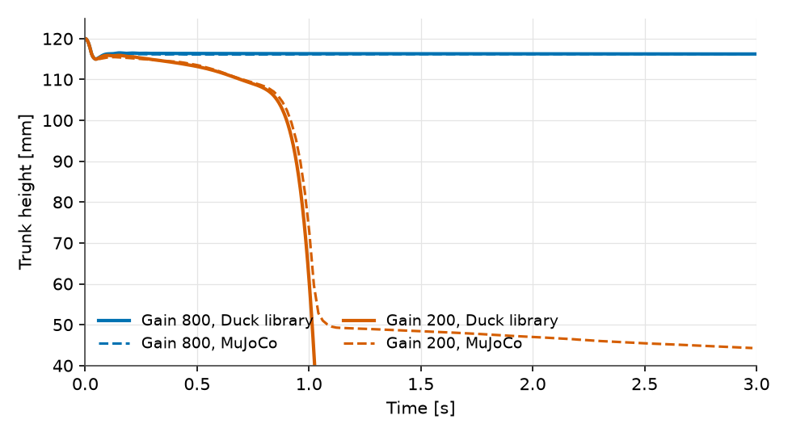
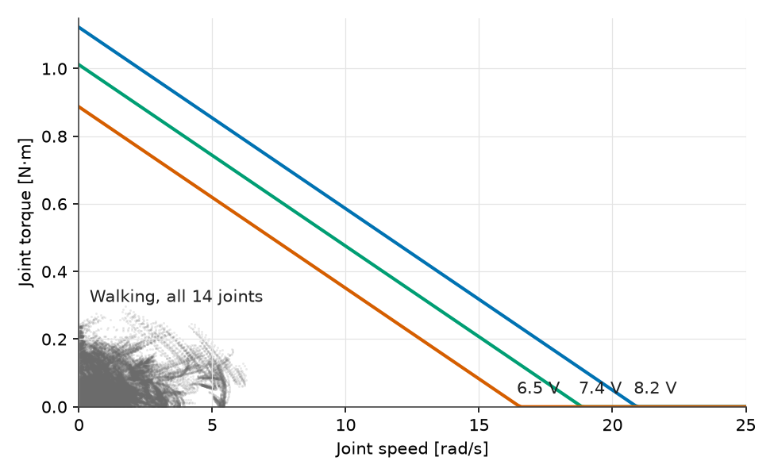

# The Servo Is a Motor, Not a Gain

Vedat Senol and Ogulcan Isitman

At the servo gain its walking policy uses, the Microduck cannot stand still.
Hold the 14 joints at the home pose with the gain register at 200 and the
robot folds and falls within a second. In MuJoCo too. Yet the same robot, at
the same gain, walks.

How can a robot walk with joints too soft to stand on?

The answer sits in the servo, and it explains why we spent more time on 14 small
motors than on the 0.737 kg of links they drive.

## From Register to Torque

The Dynamixel XL330 is a position servo. A target angle goes in over the bus,
the firmware compares it with the encoder and sets a drive fraction $u$ of the
supply voltage:

$$
u = \mathrm{clip}\!\left(g_e\,(q_{\mathrm{ref}} - q_{\mathrm{enc}}),\,-1,\,1\right),
\qquad
g_e = \frac{P \cdot 4096/2\pi}{256 \cdot 885}.
$$

$P$ is the gain register, 4096 the encoder counts per turn, 256 the firmware
gain divisor and 885 the full-drive PWM count. At $P$ = 200, $g_e$ is
0.575 per radian, so the drive saturates only beyond 100° of error.

The divisor is a trap. Read it as 128 and every joint in the model is twice
as stiff as the real one. We took 256 from the identified
model in the [BAM project](https://github.com/Rhoban/bam), whose parameters
were fitted to measured XL330 motion.

The motor itself is a DC motor seen through the gearbox:

$$
\tau = \frac{k_t}{R}\left(u V - k_t \omega\right)
- \tau_c \tanh(\omega/\omega_s) - b\,\omega,
$$

with torque constant $k_t$ = 0.346 N·m/A, resistance $R$ = 2.50 Ω, Coulomb
friction $\tau_c$ = 0.012 N·m, viscous friction $b$ = 0.0058 N·m·s/rad and
0.00157 kg·m² of rotor inertia reflected to the output. In Modelica this is a
handful of equations in one component. A `Torque` source and an `Inertia`
connect to the joint flange, and the multibody solver handles the rest.

## A Spring with Built-In Damping

Two numbers summarise the servo at small error. Stiffness:

$$
K = g_e V \frac{k_t}{R} = 0.589\ \mathrm{N\,m/rad}
$$

at 7.4 V and $P$ = 200, or about 0.01 N·m per degree. Damping from the
back-EMF, $k_t^2/R$, is 0.048 N·m·s/rad, eight times the viscous friction.
The motor brakes itself.

At gain 800 the stiffness is 2.36 N·m/rad, and the robot stands. At 200 it is
a quarter of that, and the static pose folds under its own weight.

*Figure 1: Trunk height with all 14 targets held at the home pose. Solid: the
Modelica Duck library. Dashed: MuJoCo. At gain 800 the robot settles at
116 mm. At gain 200 it passes 100 mm at 0.90 s in Modelica and 0.92 s in
MuJoCo. Only the soles collide in the Modelica model, so its fallen trunk
sinks through the floor where MuJoCo's lands.*

## How the Policy Uses a Soft Servo

During the walk the policy updates the 14 targets 50 times a second, and the
joints do not follow them closely. The left knee runs 24.5° RMS away from its
target, the right knee 23.6°. The mean error is only 5 to 8°. The target
swings well past the joint and back, every step.

That is a torque command in disguise. With 0.589 N·m/rad of stiffness, 24° of
error is about 0.25 N·m at the knee. The policy learned to move the rest point
of a soft spring, and the spring's back-EMF damping smooths the result. A stiffer
servo would change what every target means, which is a robot the policy never
saw.

How hard does the walk push the servos? Figure 2 places every joint's torque
and speed over the walk inside the motor's limits.

*Figure 2: Full-drive torque-speed limits of the XL330 model at 6.5, 7.4 and
8.2 V, and the torque and speed of all 14 joints over a 6 s walk.*

The peak is 0.30 N·m at the left knee, 30% of the 1.01 N·m stall torque at
7.4 V. The fastest joint, the left knee, reaches 6.3 rad/s against a no-load
speed of 18.9 rad/s. The walk lives in the bottom-left corner, and no servo
ever hits full drive.

## Two Details the Policy Depends On

The XL330 gear has about 2° of play, and the encoder sits after it, on the
output. The servo therefore controls the link angle through a dead zone. In the
model a smoothed tooth contact couples motor and link, and the encoder input of
the servo is wired to the link side.

Commands also arrive late. Training delayed every command by 3 to 6 physics
steps of 5 ms, 22.5 ms on average. Both effects matter. In our isolation runs,
adding the delay alone moved the Modelica walking speed from 0.158 to
0.239 m/s before the contact law was corrected, which is Part 4.

## Why Model the Servo at All?

Because every question in the rest of this series runs through it. Battery
voltage enters through $uV$, which is Part 3. A worn gear, a weak motor or a
hot winding enters through play, $V$ or $R$, which is Part 5. A training
simulator tunes an actuator until learning converges. A plant model lets each
parameter keep its physical meaning, so it can be changed one at a time.

## Limits

No load-dependent or Stribeck friction, no encoder offset, no current limit
in the firmware, and regularised Coulomb friction, so a held joint creeps
slowly. Motor parameters are BAM's identified values, not our own measurement.
