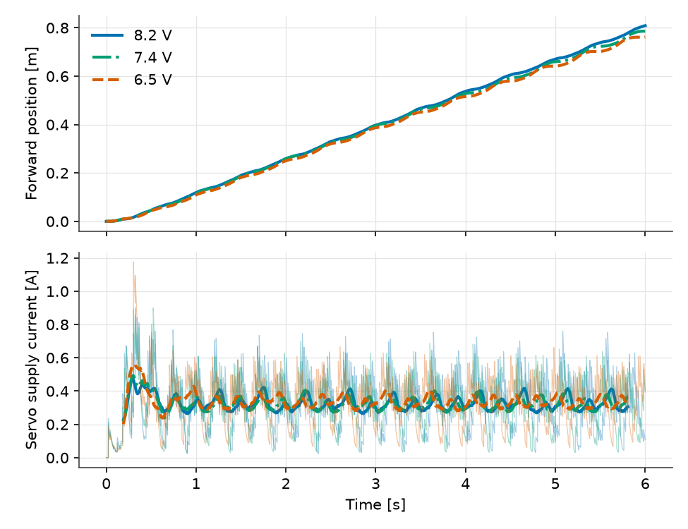

# What Does an Empty Battery Do to a Walking Robot?

Vedat Senol and Ogulcan Isitman

A two-cell lithium pack starts a session near 8.2 V and ends it near 6.5 V.
The Microduck's walking policy was trained with the supply voltage drawn at
random across exactly that range. Does the robot walk the same on a full and on
an empty pack?

MuJoCo cannot tell us directly, because its servo has no supply. The Modelica
servo from [Part 2](/posts/microduck-servo-motor/) does: voltage is a
parameter of the motor equation, and every torque downstream follows from it.

## Voltage Is Stiffness

The XL330 position controller sets a drive fraction from the position error,
and the motor sees that fraction of the supply voltage. At standstill the
restoring torque per radian of error is

$$
K = g_e \, V \, \frac{k_t}{R},
$$

with $g_e$ = 0.575 rad⁻¹ at the walking gain register of 200, $k_t$ =
0.346 N·m/A and $R$ = 2.50 Ω. So the servo stiffness is proportional to the
supply: 0.653 N·m/rad on a full pack, 0.589 at the nominal 7.4 V and
0.518 on an empty one. An empty pack makes every joint 21% softer than a full
one, and it lowers the torque-speed limit by the same ratio.

## Sweeping the Supply

We ran the closed-loop walk at a 0.3 m/s command three times, changing only the
supply voltage of all 14 servos. The supply current is summed over the servos
as drive fraction times motor current, which is what an ideal H-bridge draws
from the pack.

*Figure 1: Forward position (top) and servo supply current (bottom) at 8.2,
7.4 and 6.5 V. Thin lines: instantaneous current. Thick lines: 0.2 s moving
average.*

| Supply | Speed, last 4 s | Distance, 6 s | Mean current | Mean servo power |
| :---: | :---: | :---: | :---: | :---: |
| 8.2 V | 0.137 m/s | 0.809 m | 0.320 A | 2.63 W |
| 7.4 V | 0.132 m/s | 0.786 m | 0.318 A | 2.35 W |
| 6.5 V | 0.128 m/s | 0.762 m | 0.330 A | 2.14 W |

The servos lose 21% of their stiffness, and the robot loses 7% of its speed.
Why so little?

Our reading is that the policy closes the loop. It reads the joint angles 50
times a second and can ask for a little more where a soft joint lags,
consistent with the slightly higher mean current on the empty pack. Training
at random voltages was meant to teach it this. No servo reaches full drive at
any of the three voltages, so there is margin left.

The current peaks at 1.18 A on the empty pack, against 0.90 A on the full one.
Both peaks sit at the first touchdown, about 0.3 s in. Once the gait settles,
the 0.2 s average stays between 0.27 and 0.42 A.

## Does the Pack Sag Matter?

A real pack has internal resistance, so its terminal voltage drops with load.
How large is that drop next to the 1.7 V the pack loses over a discharge?

We have not characterised the Microduck pack. Taking 0.1 Ω for the cells and
wiring together, which is typical for a small two-cell pack, the mean current of
0.32 A drops the voltage by 32 mV and the touchdown peak by 0.12 V. Across the
sweep, speed moves 0.009 m/s over 1.7 V, so a 32 mV sag is worth about
0.0002 m/s. For this robot, state of charge matters and sag does not.

That conclusion depends on the load. A robot that saturates its servos, stands
up from the floor or carries a payload can draw several amperes, and then a
pack model with open-circuit voltage against state of charge, a series
resistance and an RC pair belongs in the loop. In Modelica that means turning
the servo's supply voltage from a parameter into an input, fed by a pack built
from standard library components, with no change to the policy.

## What It Means for Runtime

The servos alone draw 2.1 to 2.6 W during the walk, which is about 25 minutes
of continuous walking per watt-hour of pack at 7.4 V. The computer, the IMU
and the servos' own electronics come on top and are not in this model. The
model gives the motor share. A measured idle draw would complete the budget.

## Limits

An ideal voltage source per run, no servo electronics or computer load, and
copper and mechanical power only. The 0.1 Ω pack resistance is an assumption,
not a measurement. All runs are 6 s walks at one command on flat ground.
