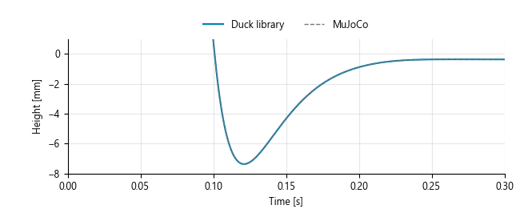
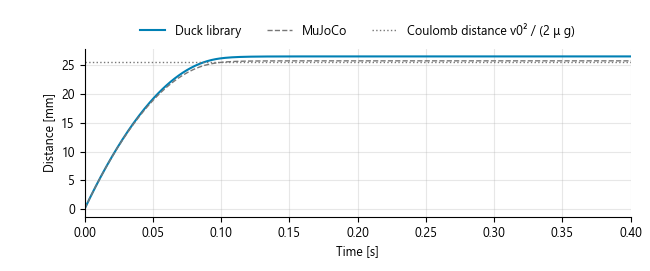
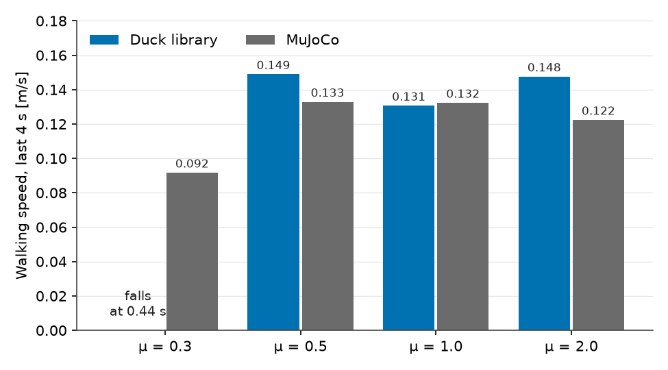

# Same Policy, 50% Faster: The Contact Law Was the Model

Vedat Senol and Ogulcan Isitman

The first time our Modelica Microduck walked under the trained policy, it
walked at 0.25 m/s. MuJoCo, running the same policy on the same robot, walked
at 0.17 m/s. Same masses, same servo model, same network weights.

A 50% gap. Where does it come from?

## Tuning Hid the Problem

Our soles started as eight spring-damper points each, the textbook penalty
contact. The obvious move was to tune the spring until the speed matched, and
it worked. At 3800 N/m per point, an earlier version of the robot walked at
0.158 m/s against MuJoCo's 0.159 m/s.

Then we dropped the robot from 30 mm. MuJoCo peaked at 65 N of sole force and
the trunk dipped to 111.2 mm. Our tuned soles peaked at 139 N and dipped only
to 115 mm. A stiffness that softened over 10 to 100 ms matched the drop, and
then every walking run fell over.

One parameter matched one test and broke the other. When that happens, the
form of the law is wrong, and its value is not the issue.

## What the Feet Were Doing

So we measured the sliding speed of the stance foot, weighted by the normal
force of each point. In MuJoCo the stance soles slip 43 mm/s. Our penalty
soles slipped 6.5 mm/s.

MuJoCo's walking speed also depended strongly on the friction coefficient,
whereas our penalty model barely reacted to it. The policy had learned to walk
on a ground that gives a little underfoot, and our ground gripped.

MuJoCo contact is not a spring. It is a soft constraint: the solver asks the
contact to reach a reference acceleration

$$
a_{\mathrm{ref}} = -b\,v - k\,d\,h,
$$

where $h$ is penetration, $v$ the velocity, $k$ and $b$ follow from a time
constant (20 ms by default) and damping ratio, and $d$ is an impedance between
0 and 1. The force then solves $(A + R)\,f = a_{\mathrm{ref}} - a_0$, with $A$
the inverse inertia the contact sees and $R = A(1-d)/d$ the regulariser that
makes the constraint soft. Friction is carried by the four edges of a pyramid,
$n \pm \mu t$, each pushing only outward. The regulariser is what lets a
loaded foot creep.

## Rebuilding the Law Point by Point

We rewrote the Modelica `PointContact` to follow that formulation, with the
same defaults and MuJoCo's own inverse weight for the foot body. Each of the 16
sole points solves its own four pyramid edges.

The single-point tests went first, against MuJoCo at a 0.1 ms time step.

*Figure 1: A 0.8 kg mass dropped 50 mm onto one contact point. Lowest point
−7.363 mm in Modelica, −7.358 mm in MuJoCo.*

*Figure 2: A mass launched along the ground slides 26.5 mm in Modelica and
25.8 mm in MuJoCo, against 25.5 mm for pure Coulomb friction.*

At MuJoCo's default 2 ms step the same drop reaches only −6.04 mm. The time
step is part of MuJoCo's contact behaviour, which is worth knowing before
comparing any simulator against it.

Then the walk. At a 0.3 m/s command both now walk at 0.131 m/s. At 0.2 m/s the
Modelica robot walks 0.098 m/s against 0.094 m/s.

## A Faster, Stateless Variant

The exact law includes the acceleration term $a_0$, which needs filtered
states and an implicit solver. A 6 s walk then takes minutes. Dropping $a_0$
gives $f = a_{\mathrm{ref}}/R$, a contact with no states that runs with
fixed-step Runge-Kutta, and the walk takes about 15 s.

The price shows at touchdown. A foot landing at 0.1 m/s peaks near 150 N
instead of about 10 N. The walking speed is unchanged, so walking uses the
stateless law and the standing, drop and slide tests use the exact one.

## Where the Match Still Breaks

A match at one friction coefficient is a calibration point, not a validation.
So we swept the friction coefficient in both simulators at a 0.3 m/s command.

*Figure 3: Walking speed over the last 4 s of a 6 s walk at four friction
coefficients. At μ = 0.3 the Modelica robot falls 0.44 s into the run.*

| μ | Modelica | MuJoCo |
| :---: | :---: | :---: |
| 0.3 | falls | 0.092 m/s |
| 0.5 | 0.149 m/s | 0.133 m/s |
| 1.0 | 0.131 m/s | 0.132 m/s |
| 2.0 | 0.148 m/s | 0.122 m/s |

How large a difference counts? The speed over the last 4 s moves by about ±5%
between equivalent Modelica runs: delaying each command by 23 ms instead of
22.5 ms is enough. Against that spread, the two agree at the nominal μ = 1 and
at μ = 0.5, where equivalent runs give 0.127 to 0.149 m/s against MuJoCo's
0.133 m/s. They part at the ends. At μ = 2.0 Modelica walks 21 to 25% faster
in every run, and on slippery ground the Modelica robot falls where MuJoCo's
keeps walking. The command dependence shows the same pattern: at 0.4 m/s
Modelica walks 0.191 m/s in every run against 0.175 m/s.

Our working hypothesis is the coupling. MuJoCo solves all active contacts of a
step together, so the points under one sole share the load and the friction.
Ours solve each point on its own. We tried coupling the eight points of a sole,
and the added lag broke walking. The question stays open.

## What This Teaches

A trained policy has learned its simulator's contact, slip included. Moving it
to a new simulator, or to hardware, changes the ground under it. A model
tuned to one test hides that, and a law matched to the original holds near
where it was matched. Only sweeping the parameters shows how far.

## Limits

Only the soles collide. The contact is point by point rather than a joint
solve. The friction cone is pyramidal, as in MuJoCo's default, with no
torsional or rolling friction. All comparisons are simulator against
simulator, with no hardware data.
