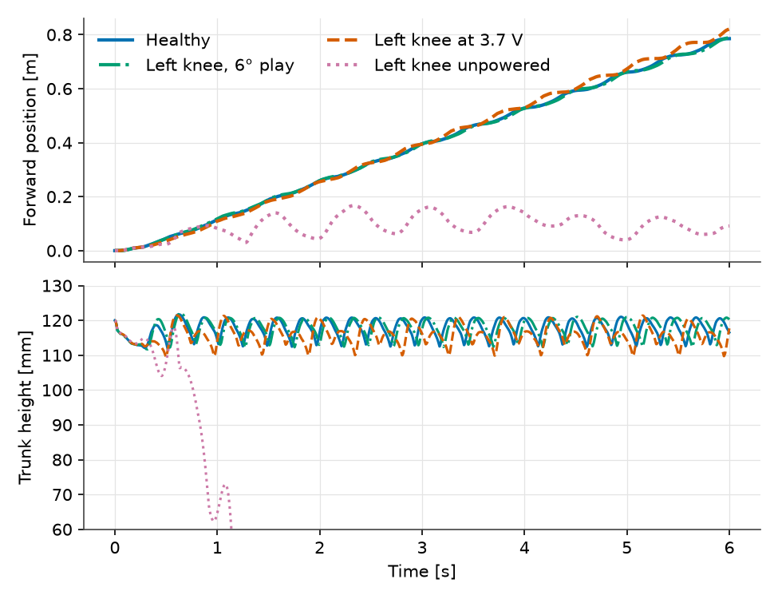
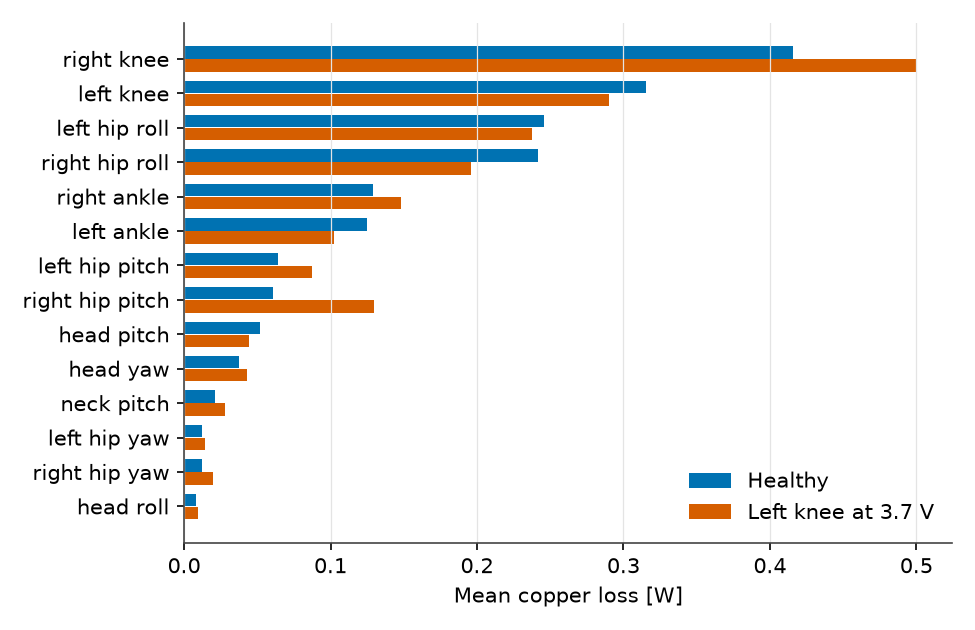

# Which Servo Failure Can a Walking Robot Survive?

Vedat Senol and Ogulcan Isitman

A servo rarely fails all at once. Its gear wears and the play grows. Its
supply connector loosens and the motor sees less voltage. Sometimes it simply
stops. A neural network walking policy was never shown most of these cases.
Which ones can the Microduck walk through?

On hardware each answer costs a damaged servo, and in a training simulator the
servo is not detailed enough to fail realistically. In the Modelica plant from
this series, a fault is one changed parameter on one joint, and the rest of
the robot, the policy included, runs unchanged.

## Three Faults on One Knee

We picked the left knee, one of the two most loaded joints, and ran the
closed-loop walk at a 0.3 m/s command with one fault at a time, present from
the start:

- **Worn gear.** Gear play of 6° instead of 2°. The encoder still reads the
  link angle through the play, as on the real servo.
- **Weak motor.** The knee sees 3.7 V instead of 7.4 V, which halves both its
  stiffness and its torque limit. A poor connector or a damaged driver does
  this.
- **Unpowered motor.** Drive fraction zero. The motor windings are shorted
  through the bridge, so back-EMF still brakes the joint, but it holds no
  position.

*Figure 1: Forward position (top) and trunk height (bottom) with a healthy
robot and three left-knee faults. Only the soles collide in this model, so
after the unpowered-knee robot falls its trunk passes through the floor and
its curves no longer mean anything physical.*

| Left knee | Speed, last 4 s | Distance, 6 s | Lowest trunk height |
| :---: | :---: | :---: | :---: |
| Healthy | 0.131 m/s | 0.785 m | 111.7 mm |
| 6° play | 0.132 m/s | 0.789 m | 111.7 mm |
| 3.7 V | 0.141 m/s | 0.821 m | 109.4 mm |
| Unpowered | Falls at 0.83 s | | |

How large a difference counts? The speed over the last 4 s moves by about ±5%
between equivalent runs. Delaying each command by 23 ms instead of 22.5 ms is
enough, so a few percent in this table is noise, not a finding.

The worn gear changes almost nothing. Training already included 2° of play,
and tripling it leaves the speed within that spread.

The weak knee is the surprise. Half the voltage halves the knee's stiffness and
torque limit, yet the robot keeps walking within a few percent of its healthy
speed, while the trunk dips 2.3 mm lower. The left knee now tracks its target
with 33° RMS error against 25° when healthy, and the policy shifts the work
elsewhere.

The unpowered knee is beyond what the policy can handle. The trunk drops below
90 mm 0.83 s into the run and the robot falls.

## Where the Heat Goes

Speed tells us whether the robot walks. It does not tell us what the walk costs
the hardware. The plant model knows the current in every motor, so copper loss
$R i^2$ per servo comes for free.

*Figure 2: Mean copper loss per servo over the last 4 s of the walk, healthy
and with the left knee at 3.7 V.*

Healthy, the 14 windings dissipate 1.74 W in total, about three quarters of the
servos' electrical power. The two knees take 0.73 W of it, and the two hip-roll
servos another 0.49 W. The head servos are almost idle.

With the weak left knee, the right knee's loss climbs from 0.42 to 0.50 W,
20% more in this run and 13 to 20% across equivalent runs. The healthy leg
pays for the faulty one. A fault on one servo turns into heat in another.

That second-order effect is the reason to run a fault study on a plant model.
A single-joint test bench would show the weak knee and miss the overloaded
right knee entirely.

## What a Thermal Model Would Add

Copper loss is the input to a temperature model, which this post does not
include. Turning watts into winding temperature needs the servo's thermal
resistance and time constant, which we have not identified for the XL330. With
those, a two-node thermal network per servo, from the standard library's heat
transfer components, would give winding temperature over a long walk.
Copper resistance rises about 0.39% per kelvin, which lowers torque, so the
loop closes back onto the mechanics.

## Beyond the Duck

The same study applies to any machine whose actuators are governed by a
controller that was tuned on a simplified model. A floating wind turbine with
one stuck blade-pitch actuator is the case we care about most, where the
question is which loads the remaining actuators and the structure must carry
until the turbine shuts down.

## Limits

Each fault is present from the start of a 6 s walk, on one joint, on flat
ground and at one command. A fault that appears mid-stride, and faults on
other joints, are separate runs. Only the soles collide, so falls are
detected, not simulated through. No thermal model is included, and no hardware
measurement backs these numbers.
