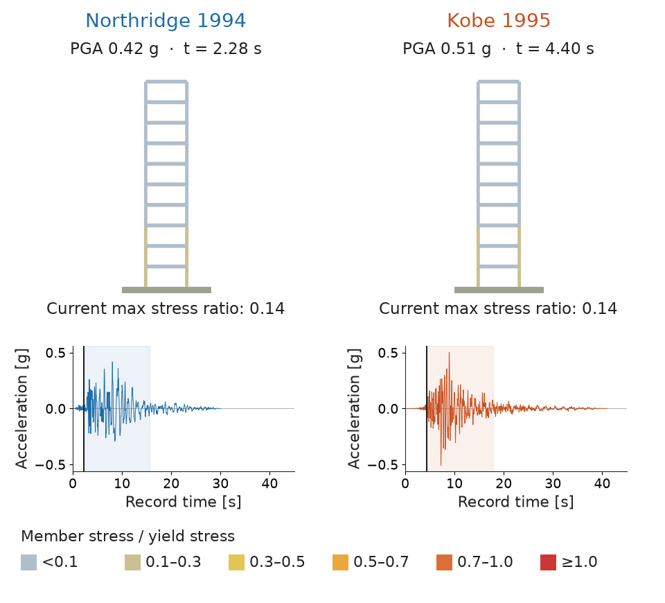
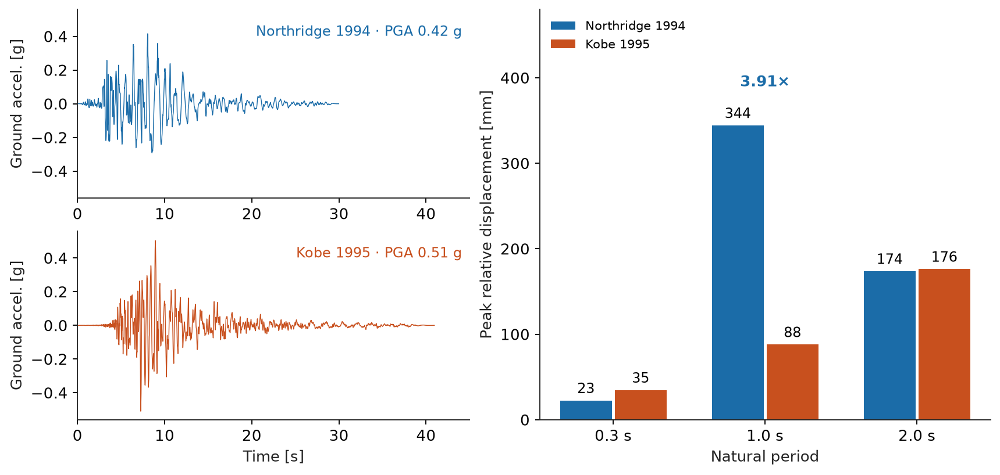
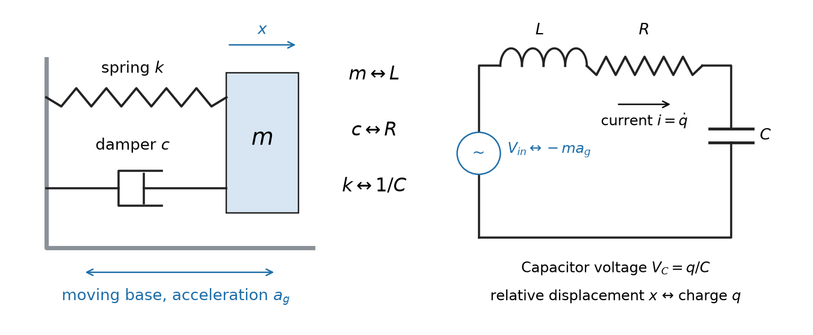
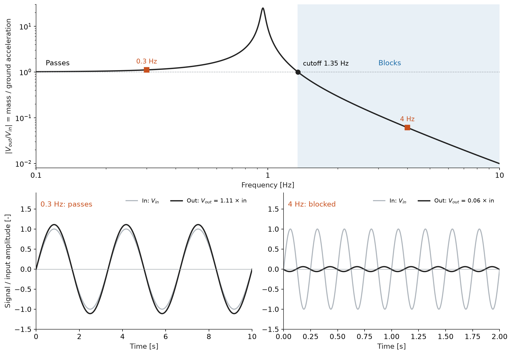
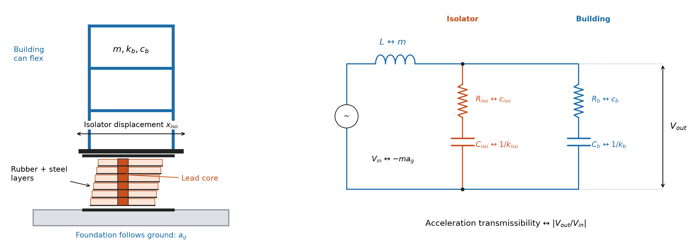
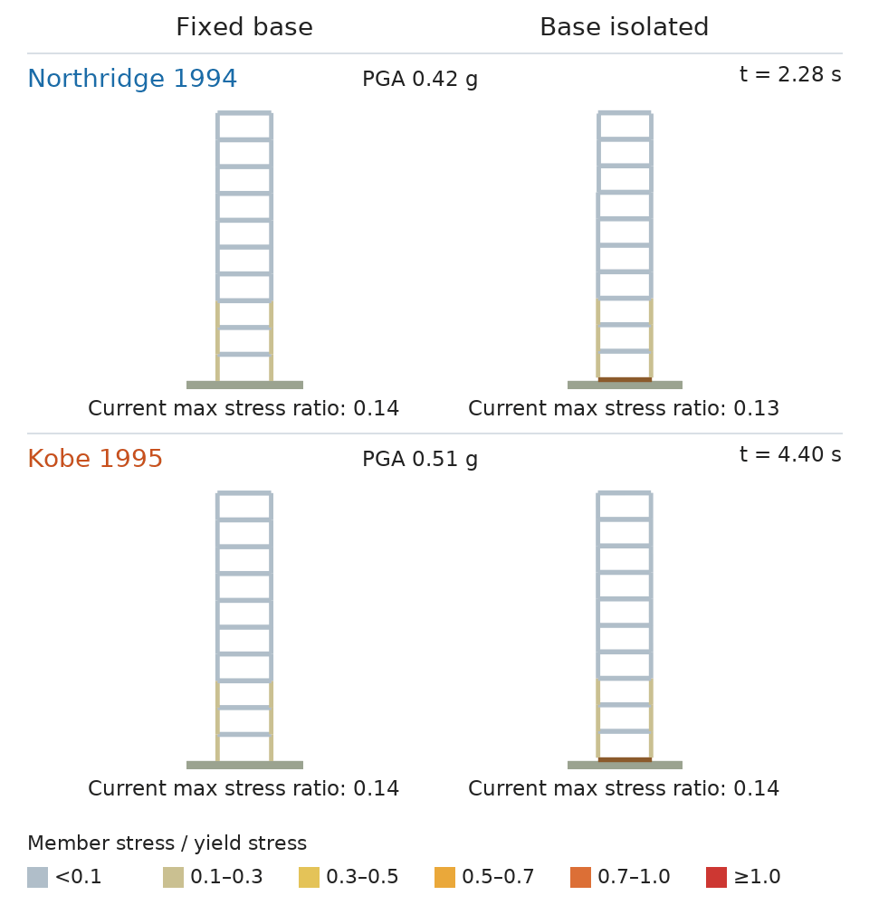
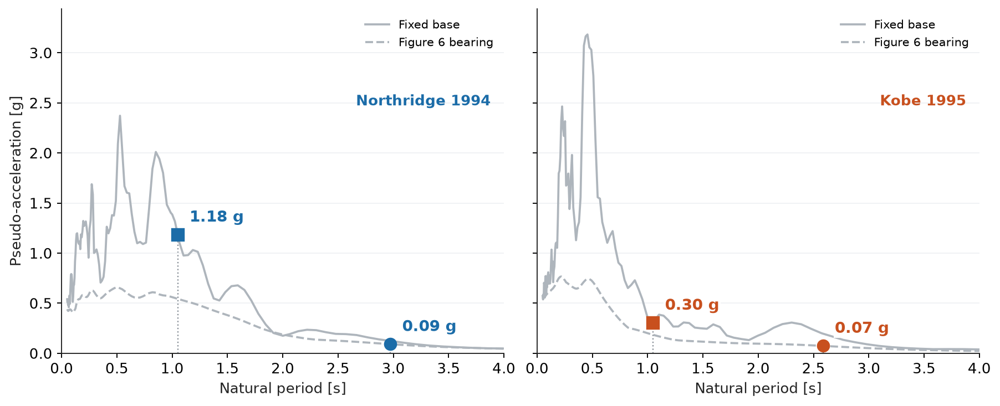
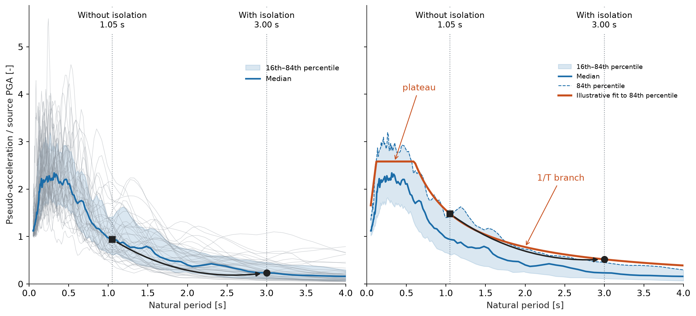

<!-- markdownlint-disable MD013 -->
<!-- Pasted into a web editor: one paragraph per line is intentional. -->

# What Can Electrical Circuits Teach Us About Earthquake Engineering?

Why does the same building sway so differently under two earthquakes? In Figure 1, peak horizontal ground acceleration (PGA) is 0.42 g for Northridge 1994 and 0.51 g for Kobe 1995, where g is gravitational acceleration. Yet peak roof displacement relative to the frame base reaches 430 mm under Northridge and 114 mm under Kobe: 3.8 times as much under the lower PGA.

*Figure 1: The same fixed-base frame, with a fundamental lateral period of about 1.05 seconds, above each ground acceleration record. Shading marks the animated window; cursors track record time. Displacements are magnified six times.*

The frame is a one-bay plane frame, 30 m tall with a 6 m bay, using S355 HEB500 for beams and columns and 20 tonnes per floor plus member masses. It is not code-designed.

Colours show each member's peak extreme-fibre stress, axial plus bending, divided by yield strength; gravity alone gives about 0.13. The simulation stays elastic, so ratios above one flag demand beyond yield, where real steel would deform permanently.

Resonance offers a starting point: like pushes timed to a swing's rhythm, shaking near a structure's natural frequency builds response over successive cycles. An earthquake's frequency content and duration therefore matter alongside its PGA.

Electrical circuits also resonate. A series resistor–inductor–capacitor (RLC) circuit follows the same equation as a structure's mass–spring–damper model. What can that connection teach us about base isolation?

## Comparing Two Records

Figure 2 uses the same two unscaled components as Figure 1: Northridge at Beverly Hills–Mulholland (MUL009) and Kobe at Nishi-Akashi (NIS000). See [source records](https://sp3risk.com/ground-motion-sets/). Each single-mass spring–damper model has 2% of critical damping.

*Figure 2: Ground accelerations (left) and single-mass models at 2% damping (right). At a one-second period, the lower-PGA record gives nearly four times the displacement.*

At a one-second period, near the frame's 1.05 seconds, Northridge produces 344 mm peak relative displacement against Kobe's 88 mm. At 0.3 seconds, Kobe leads, 35 mm against 23 mm. The single mass stands for the frame's first sway shape as a whole; the roof, the point that moves most in that shape, moves somewhat further.

## Recognizing the Circuit

A linear single-degree-of-freedom (SDOF) model under horizontal ground motion follows:

$$m\ddot{x}+c\dot{x}+kx=-ma_g.$$

Here, $x$ is displacement relative to the ground, $m$ mass, $k$ stiffness, $c$ the viscous damping coefficient and $a_g$ ground acceleration.

For a series RLC circuit, [Kirchhoff's voltage law](https://en.wikipedia.org/wiki/RLC_circuit#Series_circuit) gives $V_L+V_R+V_C=V_{in}$. With $V_L=L\,di/dt$, $V_R=Ri$, $V_C=q/C$ and $i=\dot{q}$:

$$L\ddot{q}+R\dot{q}+q/C=V_{in}.$$

In this force–voltage analogy, inductance $L$ maps to mass, resistance $R$ to damping, capacitance $C$ to flexibility $1/k$, charge $q$ to relative displacement, current to relative velocity, and source voltage $V_{in}$ to the effective earthquake force $-ma_g$.

*Figure 3: An SDOF model of lateral sway (left) and its series RLC analogue (right).*

The undamped natural period is $T=2\pi\sqrt{m/k}=2\pi\sqrt{LC}$. More mass or flexibility lengthens it.

Now take $V_{out}=V_R+V_C=V_{in}-V_L$. Mechanically, $V_L\leftrightarrow m\ddot{x}$ is the relative inertia term, and $V_R+V_C\leftrightarrow c\dot{x}+kx$ is the force through the damper and spring, the only force accelerating the mass in absolute terms. So $|V_{out}/V_{in}|=|1-V_L/V_{in}|$ is acceleration transmissibility: the mass's absolute acceleration over ground acceleration under steady sinusoidal shaking. It is close to 1 at low frequency and peaks near $1/(2\zeta)$ at resonance, about 25 at 2% damping, where $\zeta$ is the damping ratio: a second-order low-pass response.

## The Low-Pass Filter

Figure 4 shows this filter for a 1.05-second circuit. At low frequency the mass follows the ground; near resonance the output grows. Above the cutoff, √2 times the natural frequency (here 1.35 Hz), the gain falls below 1 and keeps falling: the mass increasingly stays still while the ground moves under it.

*Figure 4: Low-pass response of a 1.05-second circuit at 2% damping (top) and two sine inputs (bottom).*

## Adding Base Isolation

Figure 5 adds an orange RC branch for the isolator in parallel with the building's blue branch, both in series with the mass inductor. Added flexibility, a larger capacitance, lengthens the period: at 3 seconds, the cutoff falls from 1.35 to 0.47 Hz. This illustration assumes a linear bearing and a massless junction between layers.

*Figure 5: A bearing between foundation and building (left) and its circuit (right). Mechanical layers in series share force while their deformations add; parallel RC branches share voltage while their charges add. Subscripts: iso = isolator, b = building.*

Figure 6 repeats both records on the Figure 1 frame, now on an equivalent lead-rubber bearing (LRB).

*Figure 6: The same frame, fixed (left) and base-isolated (right), each row over its own record window. Displacements are magnified six times.*

The bearing is hysteretic and nonlinear; the frame stays elastic. The filter picture still holds approximately: at peak travel the bearing acts as a softer secant spring, setting the longer period, plus damping from its loop.

Under Northridge, peak stress ratio falls from 2.36 to 0.37, roof displacement relative to the frame base from 430 to 61 mm, and inter-storey drift ratio from 1.83% to 0.27%; the isolator travels 227 mm relative to ground. Under Kobe, these fall from 0.76 to 0.29, 114 to 54 mm and 0.50% to 0.25%, with 109 mm of isolator travel. Roof and isolator peaks occur at different times and cannot simply be added.

Both records come from FEMA P-695's far-field set, which excludes near-fault velocity pulses. A pulse-type record, such as Kobe at Takatori, can drive an isolator far further, into the moat wall around it. Such sites need larger displacement capacity, often supplemental dampers, and site-specific checks.

## Building a Response Spectrum

Repeating Figure 2's single-mass calculation for many natural periods, at fixed damping, gives a displacement response spectrum $S_d$: peak relative displacement against period. Multiplying by $k/m=(2\pi/T)^2$ gives pseudo-spectral acceleration $S_a$, peak spring force per unit mass; base shear is $mS_a$. It is "pseudo" because it equals peak absolute acceleration only without damping.

Figure 7 places the fixed-base frame at 1.05 seconds (squares) and the isolated frame at its bearing's secant period (circles): 2.97 seconds for Northridge, 2.59 for Kobe, since the bearing softens as it travels. Spring-force demand falls from 1.18 to 0.09 g and from 0.30 to 0.07 g. The price is base movement, while each bearing still carries its share of the building's weight; steel plates between its rubber layers keep it stiff vertically and soft horizontally.

*Figure 7: Pseudo-acceleration spectra. Solid: fixed base at 2% damping. Dashed: Figure 6's bearing at its peak travel.*

## From Records to a Spectral Shape

Do other records support this period shift? Figure 8 uses [FEMA P-695's far-field set](https://sp3risk.com/ground-motion-sets/): 44 horizontal components from 22 stations in 14 earthquakes, at 5% damping, each divided by its PGA. This classic teaching normalisation differs from practice, which scales records to spectral acceleration over a period range, and from Figure 7's 2% values. The blue band spans the 16th–84th percentiles.

*Figure 8: 44 FEMA P-695 spectra at 5% damping, each divided by its PGA (left), and an illustrative fit (right). Markers lie on the median and fit, not simulated responses.*

The median falls from 0.94 to 0.23 times PGA between 1.05 and 3 seconds, so the shift helps across the collection. The orange fit approximates the 84th percentile: a plateau at 2.58 times PGA to about 0.60 seconds, then 1/T decay.

This is a typical shape, not a design input: code spectra come from site hazard and soil. See [NIST guidance](https://www.nist.gov/publications/selecting-and-scaling-earthquake-ground-motions-performing-response-history-analyses), [TBEC-2018, Section 2.3.4](https://www.afad.gov.tr/kurumlar/afad.gov.tr/2309/files/TBDY_2018.pdf), whose two-period spectrum adds a long-period 1/T² branch, and the multi-period spectra of [ASCE 7-22](https://www.asce.org/communities/institutes-and-technical-groups/structural-engineering-institute/news/asce-7-22-ground-motions---a-rational-approach-for-structural-engineers/).

## What the Circuit Teaches

A structure behaves like an RLC circuit, and its transmitted acceleration is low-pass filtered, so PGA alone says little. Isolation adds capacitance, lowering the cutoff below an earthquake's strongest frequencies. The price is displacement, which the bearing and its clearance must absorb.

## Limits

One horizontal component, no vertical motion or torsion, no soil–structure interaction, elastic members, and one equivalent bearing without vertical-load coupling. These examples illustrate mechanisms, not a particular building's safety.
