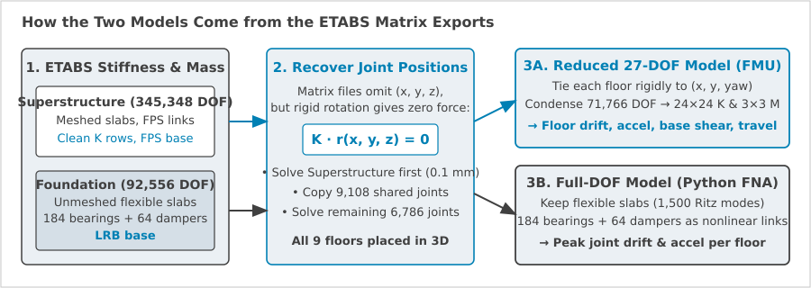
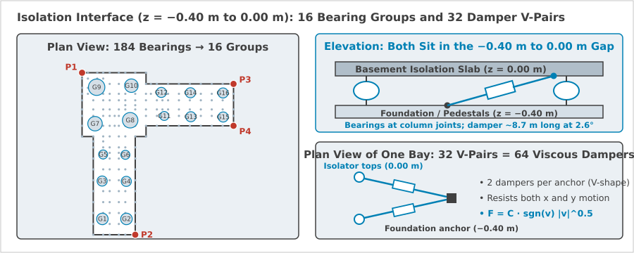
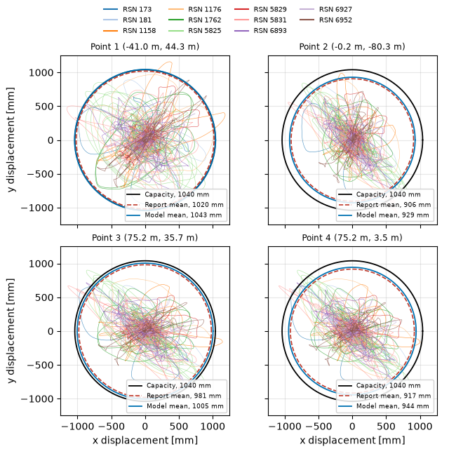
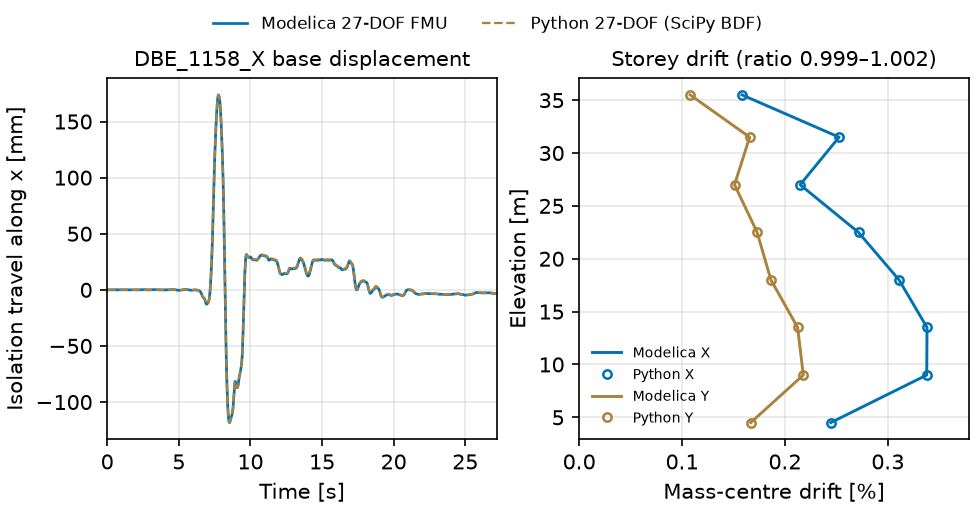

<!-- markdownlint-disable MD013 -->

# Technical Notes: Bolu FTR Hospital Isolation Study

Companion to the [blog post](https://nouseng.co/posts/bolu-hospital-isolator-sweep/) and the FMUs `BoluFrictionPendulum.fmu` and `BoluLeadRubber.fmu`. File names in code format (scripts and `data/` files) name items of the authors' working project, which this folder does not include. Source: *Bolu 250-Bed Physical Therapy and Rehabilitation Hospital, Structural Calculation Report* (*Bolu 250 Yataklı Fizik Tedavi ve Rehabilitasyon Hastanesi Statik Hesap Raporu*), isolation section, 28 April 2022. Ministry of Health (Sağlık Bakanlığı) tender archive: search İKN `2025/860174` in [EKAP](https://ekapv2.kik.gov.tr/ekap/search) and download the tender document (İhale Dokümanı).

## 1. Superstructure Matrices

- **Exports:** ETABS `DEAD`-case $K$ and lumped $M$ (N/mm/t) with Table 13.1 modifiers (`0.90` columns, `0.70` beams, `0.50` slab bending). `Foundation` (`Temel`, `92,556` DOF, unmeshed slabs) is the LRB base; `Superstructure` (`Üst Yapı`, `345,348` DOF, `1.25 m` slab mesh, `FP-DBE-UB` assigned) is the FPS base.
- **Coordinates (`bolu_matrices.py`):** free rows satisfy $K r = 0$ for rigid-body rotations $r$, which is linear in joint coordinates. Sparse least squares over `870,193` `Superstructure` rows places joints within `0.1 mm`; `Foundation` inherits them through shared labels.
- **Guyan (static) condensation:** nine levels tie rigidly to $(x, y, \theta_z)$ at the isolator centroid, and $K_c = K_{rr} - K_{rs} K_{ss}^{-1} K_{sr}$, $T^T M T$ remove the other `71,766` DOF. Holding `Basement` gives the `24 × 24` fixed-base matrix in `data/extents.json`. Each model keeps its own condensed masses: `Foundation` for LRB and fixed base, `Superstructure` for FPS (keys `*Fps`, written by `bolu_storey_properties.py fps`). $W = 1{,}080{,}837$ and $1{,}082{,}300\text{ kN}$ vs `1,078,806 kN` in Report Table 9.
- **Full model (`bolu_full_model.py`):** FNA on `1,500` Ritz vectors from the `G+nQ_TH` static state, horizontal `_X/_Y` cases at `DT / 4`, Park-Wen hysteresis and Maxwell dampers. FPS maxima span `DIAPH` joints, LRB maxima all storey joints. Results: `data/full_model_profiles.json`.

## 2. Isolation Layer and Records

Sixteen zones replace the `184` bearings (`data/isolator_groups.csv`). A Huygens-Steiner radial offset and `Utilities.Functions.balancedLoads` keep the load-weighted polar radius of gyration (`45.25 m`). The `64` dampers (`data/dampers.csv`, $C = 2.00 / 2.35 / 2.825\text{ MN}\cdot(\text{s/m})^{0.5}$ at the lower, nominal and upper bound, $\alpha = 0.5$) keep their exact 3D ends and use $v_{\text{tol}} = 10^{-3}\text{ m/s}$:

$$F_d(v) = C \frac{v}{v_{\text{ref}}} \left(\left(\frac{v}{v_{\text{ref}}}\right)^2 + \left(\frac{v_{\text{tol}}}{v_{\text{ref}}}\right)^2\right)^{(\alpha - 1)/2}$$

The frame takes `2 %` modal damping and the isolation modes `0.5 %`, as in ETABS.

Records and factors come from the `.$et` load cases (`data/load_cases.csv`). Every factor satisfies $\text{SF} = \operatorname{round}(\text{Spec Factor} \times 9{,}810,\,-1)$ (Specification EK 03, Site Class `ZC`). `_X` puts fault-parallel along $x$; `_Y` swaps.

| RSN | Earthquake (Year), Station | FN Pulse $T_p$ (s) | DD-1 Factor | DD-2 Factor | Duration (s) |
| :--- | :--- | :---: | :---: | :---: | :---: |
| `173` | Imperial Valley-06 (1979), El Centro #10 | 4.51 | 2.898 | 1.624 | 37.1 |
| `181` | Imperial Valley-06 (1979), El Centro #6 | 3.77 | 1.172 | 0.714 | 39.1 |
| `1158` | Kocaeli (1999), Duzce | - | 2.711 | 1.376 | 27.2 |
| `1176` | Kocaeli (1999), Yarimca | 4.95 | 1.713 | - | 35.0 |
| `1605` | Duzce (1999), Duzce | - | - | 0.864 | 25.9 |
| `1762` | Hector Mine (1999), Amboy | - | 4.901 | 2.481 | 60.0 |
| `5825` | El Mayor-Cucapah (2010), Cerro Prieto | - | 2.898 | 1.233 | 100.0 |
| `5829` | El Mayor-Cucapah (2010), RIITO | - | 3.109 | 2.082 | 100 / 130 |
| `5831` | El Mayor-Cucapah (2010), Ejido Saltillo | - | 3.735 | 1.564 | 130.0 |
| `6893` | Darfield (2010), DFHS | - | 4.186 | - | 150.0 |
| `6927` | Darfield (2010), LINC | 7.30 | 1.610 | 1.037 | 74.4 |
| `6952` | Darfield (2010), Riccarton H.S. | - | 1.996 | - | 150.0 |
| `6960` | Darfield (2010), Riccarton H.S. | 9.39 | - | 1.278 | 136.9 |
| `6962` | Darfield (2010), ROLC | 7.14 | - | 0.955 | 70.5 |

## 3. Verification

DD-1 lower-bound travel at the four monitored corners, model / report [mm] (Report Tables 13–14):

| System | Orientation | P1 | P2 | P3 | P4 |
| --- | --- | --- | --- | --- | --- |
| FPS | `_X` | 1029 / 1008 | 928 / 906 | 839 / 807 | 822 / 788 |
| FPS | `_Y` | 1041 / 1020 | 793 / 763 | 1003 / 981 | 942 / 917 |
| LRB | `_X` | 629 / 643 | 595 / 625 | 558 / 618 | 551 / 614 |
| LRB | `_Y` | 641 / 651 | 531 / 591 | 637 / 654 | 608 / 636 |

DD-2 upper-bound base shear, `_X` mean (Report Tables 15–16):

| System | $V_x$ model / report [MN] | $V_y$ model / report [MN] |
| --- | --- | --- |
| FPS | 150.1 / 136.7 (1.098) | 157.8 / 166.3 (0.949) |
| LRB | 281.6 / 299.5 (0.940) | 283.6 / 299.7 (0.946) |

Storey drift and floor acceleration are read as in Report §10.3.3–10.3.4: the storey maximum over all joints, then the 11-pair mean. On a rigid floor, a joint at $(x, y)$ moves $u_x - \theta (y - y_0)$ and $u_y + \theta (x - x_0)$, so the maximum lies on the extreme joint coordinates of each storey (`storeys` in `data/extents.json`). `bolu_time_history.py` (`plan_peaks`) applies this to every FMU run, and the sweep uses the same function.

Comparison chain, DD-2 upper bound unless noted:

| Step | Comparison | Quantity | Ratio (mean) |
| :--- | :--- | :---: | :---: |
| 1 | FPS full model vs our ETABS `Superstructure` run | storey drift | 0.99–1.01 |
| 1 | LRB full model vs Report Table 20 | storey drift | 0.98–1.08 |
| 1 | LRB full model vs Report Table 18, all levels | floor accel. | 0.94–1.12 |
| 2 | Modelica FMU vs Python 27-DOF ODE, `DBE_1158_X` | travel and drift | 0.999–1.002 |
| 3 | FPS 27-DOF joint max vs our ETABS `Superstructure` run | storey drift | 0.82–1.05 (0.96) |
| 3 | FPS 27-DOF joint max vs full-model joint max | floor accel. | 0.72–1.09 (0.90) |
| 3 | LRB 27-DOF joint max vs Report Table 20 | storey drift | 0.88–1.03 (0.97) |
| 3 | LRB 27-DOF joint max vs Report Table 18, `Floor 1` and up | floor accel. | 0.94–1.10 (1.04) |
| 4 | FPS Craig–Bampton 24 vs our ETABS `Superstructure` run | storey drift | 0.93–1.11 (1.04) |
| 4 | FPS Craig–Bampton 24 vs our ETABS `Superstructure` run, DD-1 upper bound | storey drift | 0.91–1.12 (1.03) |

- **FPS reference:** FPS drift is checked against our ETABS 22.6 run of the tender's `Superstructure` model (`data/etabs_fps_drifts.json`). The full model matches it within `1.2 %` on every storey under DD-2 and `2.9 %` under DD-1.
- **FPS acceleration:** the ETABS `Story Accelerations` export of the same run (`../etabs/Story Accelerations.xlsx`) returns the ground motion on `Ground`, `Floor 1`, `Floor 6` and `Floor 7` and spikes up to `129 g` on `Basement`, so it is not a joint maximum of the isolated floors. The full model on the ETABS matrices, with the same `1,500` Ritz vectors and `0.005 s` output step as the ETABS case `ModalRitz`, is the FPS acceleration reference instead.
- **LRB:** the full `Foundation` run gives Report Table 20 drift at `0.98–1.08` and Table 18 acceleration at `0.94–1.12`, including the `Ground` entrance canopy peak (`1.12 g` vs `1.19 g`). A softer report frame therefore does not explain the FPS differences.
- **Solver (step 2):** an independent 27-DOF Python ODE integration (`bolu_reduced_check.py`) matches the Modelica FMU within `0.2 %` on every storey, with isolation-centre travel of `173.7` vs `173.8 mm`.
- **Travel history (blog Figure 4):** the full model runs RSN 1176 `MCE_1176_Y` with lower-bound friction (`0.044`) and dampers on the upper-bound Ritz basis (`bolu_full_model.py` `dd1low 4 1`, with `LINK_PDELTA = False`). A rigid-body fit of the 184 bearing slips, within `18 mm`, gives the corner travel. Peaks read `0.93`, `0.98`, `1.00` and `1.00` of the 27-DOF model at Points 1 to 4. With link P-Delta ($0.5 P u$ on the `400 mm` links), the lower-bound full model diverges once bearing slips reach about `1.0 m` (RSN 1176 at `11.7 s`, RSN 5831 at `67.5 s`). The upper-bound runs, with slab travel up to `0.70 m`, stay stable. The 27-DOF model has no link P-Delta.
- **Craig–Bampton check (step 4):** `bolu_craig_bampton.py` replaces the rigid floors with a modal superstructure: the rigid-body motion of the base plus `24` load-dependent Ritz vectors of the `Superstructure` $K$ and $M$. The boundary is the one of the Guyan condensation: the `Basement` object joints follow the base in $x$, $y$ and $\theta_z$, and every other DOF stays free. Fixed-base periods are `0.898`, `0.868`, `0.723 s` against `0.894`, `0.859`, `0.719 s` for the rigid floors. The modal mass is `1.2 %` above the condensed floors, because the rigid-body shapes carry the isolator-top joints in full. Drift against ETABS improves from `0.82–1.05` to `0.93–1.11` on DD-2 and from `0.82–1.10` to `0.91–1.12` on DD-1 upper bound, mainly at `Floor 6` and `Floor 7`. Base shear stays `0.154 W` and DD-1 travel moves from `988` to `998 mm`. Each run takes about `17 s` against `2.5 s`, plus joint recovery from `data/cb_shapes.npz`.
- **Sensitivity:** halving or quartering the time step, a `16×` range of pre-sliding stiffness, or `0.5 %` frame damping moves FPS drift by at most `6 %`.

*Same equations, two solvers on `DBE_1158_X`: Modelica FMU vs Python SciPy BDF base displacement and storey drifts (`0.999` to `1.002`).*

The figures in `verification/` add the full model to the blog's drift and acceleration plots and the Craig–Bampton model to the FPS drift plots, for DD-2 (`ReportDrift.png`) and DD-1 upper bound (`ReportDriftMCE.png`). They also hold the LRB parity plot and the FPS DD-2 / DD-1 drift levels against ETABS.

## 4. TBDY 2018 Chapter 14 Bearing Sweep

`bolu_bearing_sweep.py` runs each design at 11 pairs × 2 orientations × 3 bounds (`66` runs), dampers fixed at the report design. TBDY §14.0.2 counts the dampers as part of the isolation system, and every ETABS model pairs the friction links with the damper link of the same bound (`FP-DBE-UB` and `FP-MCE-UB` with `VD_UB`, `FP_MCE-LB` with `VD_LB`). This study follows that pairing. Damper $C$ is the nominal `2.35` MN·(s/m)^0.5 of the damper specification times its own factors, $\lambda_{\max} = 1.20$ and $\lambda_{\min} = 0.85$ (aging and test scatter). Mixed bounds, such as upper-bound friction with lower-bound dampers, are not run. TBDY does not require them, but they are worth a run, because the two devices have separate factors. Upper bound is $1.5\mu$ for FPS and Report Table 10 factors `(1.6445, 1.9435)` on $(Q_d, K_2)$ for LRB; lower bound is $0.8\mu$ and `(0.595, 0.765)`. Limits: DD-2 upper-bound drift $\le 0.50\text{ \%}$ and $V \le 0.20\,W$ (Ministry of Health requirements as stated in the report, §9 and §11; bound per TBDY §14.3.6), DD-2 nominal floor acceleration $\le 0.30\text{ g}$ (Ministry specification §3.2.21, Report §9; TBDY §14.3.10 permits nominal values), DD-1 lower-bound $D_{TM} \le 1.04\text{ m}$ (FPS) or $0.75\text{ m}$ (LRB), and LRB rubber shear strain $\le 250\text{ \%}$. Drift and acceleration are rigid-floor joint maxima with torsion (§3). $D_{TM}$ is the worst corner and orientation of the 11-pair mean of the peak vector travel (TBDY §14.14.4.4–14.14.4.5). All designs pass TBDY §14.3.7 (restoring force and wind) and $T_d \le 6\text{ s}$, except LRB D1000 L250 Tr450 G0.4 ($T_d = 6.01$ s), which is not run. The `7,062` runs took `2 h 57 min` to `3 h 34 min` on eight worker processes.

**Capacity basis.** The `1.04 m` and `0.75 m` capacities are design choices of the report, not TBDY limits. TBDY 2018 only requires prototype tests at $1.00\,D_{TM}$ (Table 14.4), so the capacity must be at least $D_{TM}$. The report's chain:

1. The ministry limits (`0.30 g`, `0.20 W`) with isolators alone gave travel too large to build, so the designers chose $R = 7.4$ m and added viscous dampers (§9, p. 19).
2. About `±1.0 m` travel and $V < 0.20\,W$ needed about `42 %` total damping at DD-1, `28–32 %` from the dampers (p. 21).
3. The equivalent lateral force method, DD-1 lower bound, converges on $D_M = 1.00$ m: $V = W(0.044 + 1.00/7.4) = 0.179\,W$, $T_{eff} = 4.74$ s, $\xi_{eff} = 42.1\,\%$, $S_{ae} = 0.390$ g, $\beta = 2.171$ (§10.2.1, p. 29).
4. The time-history means reach `1,020 mm` at the worst corner, and the mass-centre travel gives $1.1 \times 906 = 997$ mm. The capacity is set at `1,040 mm` for FPS and `750 mm` for LRB (§10.3.1, pp. 33–34; §11, p. 42: "Isolator displacement capacity = ~104 cm" (İzolatör Deplasman Kapasitesi)).

Two points rest on our reading of TBDY. The `1.00 m` uses `42 %` damping, above the `30 %` of §14.14.3.5, which the report applies only to the base shear. With `30 %`, one step of the same formula gives about `1.16 m` (not iterated). The equivalent-load $D_{TM} \ge 1.1\,D_M = 1.10$ m (§14.14.2.6) also exceeds `1.04 m`; the report relies on the time history instead, which §14.14.4.6 allows down to `80 %` of that value.

### Catalogue Basis

The grid spans catalogue ranges. The rows list only values read on the maker's own pages (28 November 2026). Turkish makers are marked **[TR]**.

| Maker | Type | Published values | Used for |
| :--- | :--- | :--- | :--- |
| [Maurer SIP-D](https://www.maurer.eu/fileadmin/downloadcenter/TI_004_EN.pdf) | FPS | $R_{eff}$ = 1.5–5 m, $\mu$ = 3.0 % or 5.5 % | $R$ up to 5 m, $\mu$ |
| [Bridgestone LH](https://www.bridgestone.com/products/diversified/antiseismic_rubber/pdf/catalog_201710.pdf) | LRB | $D_o$ = 600–1500 mm, standard lead $D_o/5$, $T_r$ ≈ 200 mm, $G$ = 0.385 MPa, lead ≈ 8 MPa (from $Q_d$) | $D_o$, lead ratio, lead stress |
| **[TR]** [Arsan ATLAS](https://www.arsan.com/en/urunlerimiz/yapi-urunleri/kursun-cekirdekli-kaucuk-izolator/) | LRB | CE to EN 15129, designed per project | — |
| **[TR]** [Fago](https://fagosismikizolasyon.com/lrb-lead-rubber-bearing/) | LRB, FPS | LRB shear strain up to 450 % claimed | — |
| **[TR]** [TİS](https://tis.com.tr/sss) | FPS (TDP) | Diameter 500–2000 mm, sized per project | — |
| **[TR]** [Arfen](https://arfen.com.tr/sismik-izolatorler) | LRB, HDRB, FPS | LRB movement 70–200 % of bearing height | — |

The values $\mu$ = 0.02, 0.08 and 0.10, $R$ = 2.65 m, $G$ = 0.4 and 0.6 MPa and $T_r$ = 250–450 mm extend these ranges. We found no catalogue page that confirms them.

FPS grid: $R$ = 2.0, 2.65, 3.0, 4.0, 5.0, 6.0, 7.4 m × $\mu$ = 0.02, 0.03, 0.055, 0.08, 0.10 (`35` designs). $R = 6$ m lies beyond the Maurer range, and $R = 7.4$ m is the report and ETABS value (`RADIUS 7400`). LRB grid: $D_o$ = 1.0–1.5 m in 0.1 m steps × lead $d_l/D_o$ = 0.20, 0.25 × $T_r$ = 250, 300, 450 mm × $G$ = 0.4, 0.6 MPa, lead yield stress 8 MPa (`72` designs), plus the report LRB (`G` 0.6 MPa, lead 11 MPa).

### Friction Pendulum Results

Cells give DD-1 lower-bound $D_{TM}$ [m] / DD-2 upper-bound $V/W$ / DD-2 nominal peak floor acceleration [g]. Bold cells meet every limit except floor acceleration. Upper-bound drift stays at `0.19` to `0.40 %` and governs no FPS design. The report design reaches $D_{TM} = 1.043$ m (`_Y` orientation, Point 1), at its `1.04 m` capacity within model scatter: the full 3D model reads `0.93` to `1.00` of the 27-DOF corner peaks (§3).

| $R$ [m] | $T_d$ [s] | $\mu = 0.02$ | $\mu = 0.03$ | $\mu = 0.055$ | $\mu = 0.08$ | $\mu = 0.1$ |
| :--- | :---: | :---: | :---: | :---: | :---: | :---: |
| 2 | 2.84 | **0.921 / 0.162 / 0.48** | **0.864 / 0.159 / 0.55** | **0.736 / 0.173 / 0.70** | **0.623 / 0.196 / 0.83** | 0.549 / 0.218 / 0.92 |
| 2.65 | 3.27 | 1.045 / 0.148 / 0.46 | **0.973 / 0.147 / 0.54** | **0.814 / 0.164 / 0.70** | **0.676 / 0.190 / 0.82** | 0.588 / 0.213 / 0.93 |
| 3 | 3.48 | 1.090 / 0.142 / 0.47 | **1.007 / 0.142 / 0.54** | **0.837 / 0.161 / 0.71** | **0.697 / 0.187 / 0.83** | 0.610 / 0.211 / 0.94 |
| 4 | 4.01 | 1.266 / 0.130 / 0.46 | 1.153 / 0.133 / 0.52 | **0.930 / 0.156 / 0.71** | **0.767 / 0.183 / 0.83** | 0.659 / 0.208 / 0.95 |
| 5 | 4.49 | 1.326 / 0.122 / 0.45 | 1.217 / 0.127 / 0.51 | **0.993 / 0.152 / 0.71** | **0.807 / 0.181 / 0.83** | 0.684 / 0.206 / 0.95 |
| 6 | 4.91 | 1.369 / 0.117 / 0.44 | 1.269 / 0.123 / 0.52 | **1.030 / 0.150 / 0.71** | **0.828 / 0.180 / 0.83** | 0.698 / 0.205 / 0.94 |
| 7.4 (report) | 5.46 | 1.398 / 0.112 / 0.44 | 1.295 / 0.120 / 0.52 | 1.043 / 0.149 / 0.71 | **0.837 / 0.179 / 0.83** | 0.706 / 0.204 / 0.94 |

### Lead-Rubber Results

No LRB design meets shear, travel and strain together. The `17` designs above the `0.50 %` drift limit also exceed `0.20 W`. $Q_d/W$ is the nominal characteristic strength.

| Design | $T_d$ [s] | $Q_d/W$ | Upper drift [%] | Nominal accel [g] | $V/W$ | $D_{TM}$ [m] | Strain [%] |
| :--- | :---: | :---: | :---: | :---: | :---: | :---: | :---: |
| Report D1450 L300 Tr450 G0.6 | 3.45 | 0.132 | 0.544 | 0.63 | 0.289 | 0.689 | 153 |
| D1000 L200 Tr250 G0.4 | 4.43 | 0.043 | 0.301 | 0.41 | 0.165 | 1.270 | 508 |
| D1000 L200 Tr250 G0.6 | 3.61 | 0.043 | 0.321 | 0.45 | 0.181 | 1.152 | 461 |
| D1000 L200 Tr300 G0.4 | 4.85 | 0.043 | 0.289 | 0.39 | 0.160 | 1.296 | 432 |
| D1000 L200 Tr300 G0.6 | 3.96 | 0.043 | 0.313 | 0.43 | 0.173 | 1.211 | 404 |
| D1000 L200 Tr450 G0.4 | 5.94 | 0.043 | 0.269 | 0.38 | 0.151 | 1.279 | 284 |
| D1000 L200 Tr450 G0.6 | 4.85 | 0.043 | 0.289 | 0.39 | 0.160 | 1.296 | 288 |
| D1000 L250 Tr250 G0.4 | 4.48 | 0.067 | 0.366 | 0.42 | 0.199 | 1.113 | 445 |
| D1000 L250 Tr250 G0.6 | 3.66 | 0.067 | 0.381 | 0.49 | 0.211 | 1.005 | 402 |
| D1000 L250 Tr300 G0.4 | 4.91 | 0.067 | 0.353 | 0.40 | 0.194 | 1.136 | 379 |
| D1000 L250 Tr300 G0.6 | 4.01 | 0.067 | 0.376 | 0.46 | 0.205 | 1.063 | 354 |
| D1000 L250 Tr450 G0.6 | 4.91 | 0.067 | 0.353 | 0.40 | 0.194 | 1.136 | 252 |
| D1100 L220 Tr250 G0.4 | 4.02 | 0.052 | 0.335 | 0.44 | 0.183 | 1.162 | 465 |
| D1100 L220 Tr250 G0.6 | 3.29 | 0.052 | 0.352 | 0.48 | 0.201 | 0.993 | 397 |
| D1100 L220 Tr300 G0.4 | 4.41 | 0.052 | 0.325 | 0.42 | 0.177 | 1.207 | 402 |
| D1100 L220 Tr300 G0.6 | 3.60 | 0.052 | 0.345 | 0.47 | 0.192 | 1.085 | 362 |
| D1100 L220 Tr450 G0.4 | 5.40 | 0.052 | 0.299 | 0.39 | 0.167 | 1.238 | 275 |
| D1100 L220 Tr450 G0.6 | 4.41 | 0.052 | 0.325 | 0.42 | 0.177 | 1.207 | 268 |
| D1100 L275 Tr250 G0.4 | 4.07 | 0.081 | 0.414 | 0.46 | 0.224 | 0.991 | 396 |
| D1100 L275 Tr250 G0.6 | 3.33 | 0.081 | 0.424 | 0.55 | 0.235 | 0.858 | 343 |
| D1100 L275 Tr300 G0.4 | 4.46 | 0.081 | 0.407 | 0.43 | 0.221 | 1.029 | 343 |
| D1100 L275 Tr300 G0.6 | 3.64 | 0.081 | 0.420 | 0.52 | 0.229 | 0.925 | 308 |
| D1100 L275 Tr450 G0.4 | 5.46 | 0.081 | 0.370 | 0.40 | 0.210 | 1.075 | 239 |
| D1100 L275 Tr450 G0.6 | 4.46 | 0.081 | 0.407 | 0.43 | 0.221 | 1.029 | 229 |
| D1200 L240 Tr250 G0.4 | 3.69 | 0.062 | 0.367 | 0.48 | 0.203 | 1.042 | 417 |
| D1200 L240 Tr250 G0.6 | 3.01 | 0.062 | 0.386 | 0.52 | 0.221 | 0.888 | 355 |
| D1200 L240 Tr300 G0.4 | 4.04 | 0.062 | 0.361 | 0.45 | 0.197 | 1.101 | 367 |
| D1200 L240 Tr300 G0.6 | 3.30 | 0.062 | 0.374 | 0.50 | 0.213 | 0.943 | 314 |
| D1200 L240 Tr450 G0.4 | 4.95 | 0.062 | 0.337 | 0.40 | 0.185 | 1.172 | 260 |
| D1200 L240 Tr450 G0.6 | 4.04 | 0.062 | 0.361 | 0.45 | 0.197 | 1.101 | 245 |
| D1200 L300 Tr250 G0.4 | 3.73 | 0.096 | 0.457 | 0.53 | 0.247 | 0.869 | 348 |
| D1200 L300 Tr250 G0.6 | 3.05 | 0.096 | 0.472 | 0.61 | 0.259 | 0.751 | 300 |
| D1200 L300 Tr300 G0.4 | 4.09 | 0.096 | 0.451 | 0.48 | 0.245 | 0.916 | 305 |
| D1200 L300 Tr300 G0.6 | 3.34 | 0.096 | 0.463 | 0.58 | 0.253 | 0.798 | 266 |
| D1200 L300 Tr450 G0.4 | 5.01 | 0.096 | 0.424 | 0.42 | 0.237 | 0.980 | 218 |
| D1200 L300 Tr450 G0.6 | 4.09 | 0.096 | 0.451 | 0.48 | 0.245 | 0.916 | 203 |
| D1300 L260 Tr250 G0.4 | 3.41 | 0.072 | 0.399 | 0.52 | 0.223 | 0.915 | 366 |
| D1300 L260 Tr250 G0.6 | 2.78 | 0.072 | 0.425 | 0.57 | 0.240 | 0.802 | 321 |
| D1300 L260 Tr300 G0.4 | 3.73 | 0.072 | 0.395 | 0.49 | 0.217 | 0.989 | 330 |
| D1300 L260 Tr300 G0.6 | 3.05 | 0.072 | 0.410 | 0.55 | 0.231 | 0.845 | 282 |
| D1300 L260 Tr450 G0.4 | 4.57 | 0.072 | 0.379 | 0.42 | 0.206 | 1.085 | 241 |
| D1300 L260 Tr450 G0.6 | 3.73 | 0.072 | 0.395 | 0.49 | 0.217 | 0.989 | 220 |
| D1300 L325 Tr250 G0.4 | 3.45 | 0.113 | 0.501 | 0.59 | 0.269 | 0.755 | 302 |
| D1300 L325 Tr250 G0.6 | 2.81 | 0.113 | 0.526 | 0.65 | 0.282 | 0.660 | 264 |
| D1300 L325 Tr300 G0.4 | 3.78 | 0.113 | 0.493 | 0.54 | 0.265 | 0.804 | 268 |
| D1300 L325 Tr300 G0.6 | 3.08 | 0.113 | 0.512 | 0.64 | 0.276 | 0.698 | 233 |
| D1300 L325 Tr450 G0.4 | 4.62 | 0.113 | 0.472 | 0.45 | 0.261 | 0.887 | 197 |
| D1300 L325 Tr450 G0.6 | 3.78 | 0.113 | 0.493 | 0.54 | 0.265 | 0.804 | 179 |
| D1400 L280 Tr250 G0.4 | 3.16 | 0.084 | 0.436 | 0.57 | 0.242 | 0.816 | 326 |
| D1400 L280 Tr250 G0.6 | 2.58 | 0.084 | 0.466 | 0.61 | 0.259 | 0.717 | 287 |
| D1400 L280 Tr300 G0.4 | 3.46 | 0.084 | 0.429 | 0.54 | 0.236 | 0.874 | 291 |
| D1400 L280 Tr300 G0.6 | 2.83 | 0.084 | 0.450 | 0.60 | 0.250 | 0.766 | 255 |
| D1400 L280 Tr450 G0.4 | 4.24 | 0.084 | 0.419 | 0.45 | 0.227 | 0.994 | 221 |
| D1400 L280 Tr450 G0.6 | 3.46 | 0.084 | 0.429 | 0.54 | 0.236 | 0.874 | 194 |
| D1400 L350 Tr250 G0.4 | 3.20 | 0.131 | 0.548 | 0.66 | 0.292 | 0.658 | 263 |
| D1400 L350 Tr250 G0.6 | 2.61 | 0.131 | 0.584 | 0.70 | 0.305 | 0.578 | 231 |
| D1400 L350 Tr300 G0.4 | 3.51 | 0.131 | 0.540 | 0.62 | 0.287 | 0.702 | 234 |
| D1400 L350 Tr300 G0.6 | 2.86 | 0.131 | 0.565 | 0.68 | 0.300 | 0.612 | 204 |
| D1400 L350 Tr450 G0.4 | 4.29 | 0.131 | 0.513 | 0.48 | 0.281 | 0.789 | 175 |
| D1400 L350 Tr450 G0.6 | 3.51 | 0.131 | 0.540 | 0.62 | 0.287 | 0.702 | 156 |
| D1500 L300 Tr250 G0.4 | 2.95 | 0.096 | 0.476 | 0.61 | 0.261 | 0.739 | 296 |
| D1500 L300 Tr250 G0.6 | 2.41 | 0.096 | 0.511 | 0.65 | 0.280 | 0.643 | 257 |
| D1500 L300 Tr300 G0.4 | 3.23 | 0.096 | 0.465 | 0.59 | 0.255 | 0.780 | 260 |
| D1500 L300 Tr300 G0.6 | 2.64 | 0.096 | 0.493 | 0.64 | 0.270 | 0.685 | 228 |
| D1500 L300 Tr450 G0.4 | 3.96 | 0.096 | 0.453 | 0.49 | 0.246 | 0.900 | 200 |
| D1500 L300 Tr450 G0.6 | 3.23 | 0.096 | 0.465 | 0.59 | 0.255 | 0.780 | 173 |
| D1500 L375 Tr250 G0.4 | 2.99 | 0.150 | 0.596 | 0.71 | 0.316 | 0.578 | 231 |
| D1500 L375 Tr250 G0.6 | 2.44 | 0.150 | 0.639 | 0.75 | 0.329 | 0.505 | 202 |
| D1500 L375 Tr300 G0.4 | 3.27 | 0.150 | 0.587 | 0.68 | 0.310 | 0.613 | 204 |
| D1500 L375 Tr300 G0.6 | 2.67 | 0.150 | 0.619 | 0.72 | 0.322 | 0.539 | 180 |
| D1500 L375 Tr450 G0.4 | 4.01 | 0.150 | 0.558 | 0.55 | 0.299 | 0.693 | 154 |
| D1500 L375 Tr450 G0.6 | 3.27 | 0.150 | 0.587 | 0.68 | 0.310 | 0.613 | 136 |
